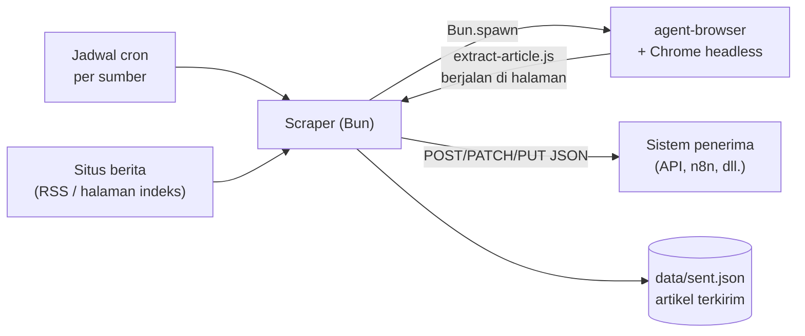

# News Scraper dengan agent-browser

Scraper berita berbasis [Bun](https://bun.sh) dan [agent-browser](https://github.com/vercel-labs/agent-browser) (CLI otomasi Chrome dari Vercel Labs). Untuk setiap artikel, scraper mengambil **URL, metadata, isi penuh, dan URL gambar**, lalu mengirimnya ke sistem mana pun lewat **HTTP POST/PATCH/PUT** berisi JSON.



## Fitur

- **Data lengkap per artikel:** judul, deskripsi, penulis, tanggal terbit/diperbarui, seksi, tag, isi teks penuh, jumlah kata, gambar utama, dan gambar di dalam isi (termasuk lazy-load).
- **Artikel multi-halaman:** memakai versi "tampilkan semua" jika ada, atau mengikuti halaman 2, 3, ... lalu menggabungkan isinya.
- **Pengiriman andal:** ID artikel stabil (`Idempotency-Key`), retry dengan jeda bertahap untuk `408`/`429`/`5xx`, dan artikel baru dicatat terkirim setelah penerima membalas `2xx`.
- **Tanpa duplikat:** artikel yang sudah terkirim dilewati pada jalan berikutnya.
- **Server dengan jadwal cron per sumber:** setiap sumber punya `schedule` sendiri (mis. tiap 15 menit, tiap jam), dijalankan bergiliran lewat antrean serial, dengan `GET /health`, `GET /status`, dan graceful shutdown.
- **Driver browser bisa dipilih:** agent-browser (default), Playwright, atau CDP langsung dari Bun, lewat env `BROWSER_DRIVER`; ketiganya memakai ekstraktor yang sama.
- **Tanpa token AI:** seluruh alur deterministik; agent-browser hanya alat otomasi browser.
- **Hampir tanpa dependency:** hanya API Bun, ditambah `playwright-core` yang dipakai jika driver `playwright` dipilih; clean architecture dengan unit test `bun:test`.

## Mulai cepat

Kebutuhan: Bun ≥ 1.4.4, Node.js/npm (untuk memasang agent-browser).

```bash
# 1. agent-browser + Chrome
npm install -g agent-browser@0.41.1
agent-browser install

# 2. Konfigurasi
cd scraper
cp .env.example .env          # isi WEBHOOK_URL dan WEBHOOK_TOKEN

# 3. Coba tanpa mengirim apa pun
bun run dry-run

# 4. Uji kirim ke penerima tiruan
bun run mock                  # terminal 1: http://localhost:8080
bun run once                  # terminal 2: hasil di data/received.jsonl
```

Jalankan sebagai server dengan `bun start`: setiap sumber berjalan sesuai `sources[].schedule` di `config.json`, dan kondisinya bisa dilihat di `http://127.0.0.1:3000/status`. Unit test: `bun test`.

## Contoh data yang dikirim

```json
{
  "id": "f93e573f77d31000aef85ad479252985",
  "source": "antaranews",
  "scraped_at": "2026-11-01T16:05:13.244Z",
  "article": {
    "url": "https://www.antaranews.com/berita/5825335/...",
    "title": "Anggota DPR usul pembentukan TGPF ...",
    "authors": ["Bagus Ahmad Rizaldi"],
    "published_at": "2026-11-01T22:59:19+07:00",
    "tags": ["PENGGELEDAHAN PONPES", "POLDA JAWA TENGAH"],
    "main_image": "https://cdn.antaranews.com/cache/1200x800/2026/11/01/1000094283.jpg",
    "images": [{ "url": "https://cdn.antaranews.com/...jpg", "caption": null }],
    "content_text": "Jakarta (ANTARA) - ...",
    "word_count": 390,
    "page_count": 1,
    "pagination_mode": "single"
  }
}
```

Daftar field lengkap, header, dan perilaku terhadap setiap status respons ada di [scraper/README.md: Kontrak untuk sistem penerima](scraper/README.md#kontrak-untuk-sistem-penerima).

## Struktur repo

| Path | Isi |
|---|---|
| [`scraper/`](scraper/) | Kode scraper (Bun), konfigurasi, test, dan penerima tiruan. Dokumentasi utama: [scraper/README.md](scraper/README.md) |
| [`docs/adr/`](docs/adr/) | Architecture Decision Record: [ADR-0001 agent-browser di server](docs/adr/0001-penggunaan-agent-browser-di-server.md), [ADR-0002 server dengan jadwal cron per sumber](docs/adr/0002-scraper-sebagai-server-dengan-jadwal-cron-per-sumber.md), [ADR-0003 driver browser: agent-browser, Playwright, atau CDP](docs/adr/0003-driver-browser-agent-browser-playwright-atau-cdp.md), [ADR-0004 ekstraksi dengan Hermes Agent (ditolak)](docs/adr/0004-ekstraksi-artikel-dengan-hermes-agent.md) |
| [`docs/reserch/`](docs/reserch/) | Riset perbandingan tools scraping berita |
| [`.claude/`](.claude/) | Konteks dan skill untuk Claude Code: aturan project, gaya komentar, penulisan dokumen, cara menambah sumber berita |

## Sumber berita yang dikonfigurasi

| Sumber | Jadwal | Discovery | Catatan |
|---|---|---|---|
| antaranews.com | `*/15 * * * *` (tiap 15 menit) | RSS `/rss/terkini.xml` | Artikel satu halaman |
| kompas.com | `0 * * * *` (tiap jam) | Halaman indeks `indeks.kompas.com` | **Jangan dijalankan tanpa izin tertulis:** `robots.txt` Kompas melarang scraping otomatis |

Sumber baru ditambahkan di `scraper/config.json`. Periksa `robots.txt` dan ToS situs terlebih dahulu; scraper tidak memeriksanya otomatis.

## Status

- Diuji di Windows 11 dengan Bun 1.4.4, agent-browser 0.41.1, dan Chrome 156 (1 November 2026).
- Driver `playwright` dan `cdp` lolos uji integrasi dengan halaman lokal di Windows dan di Docker Linux; ketiga driver menghasilkan payload identik pada dry-run antaranews (2 November 2026). Rinciannya di [scraper/README.md: Driver browser](scraper/README.md#driver-browser).
- Instalasi dan operasi penuh di server Linux atau Docker **belum diuji**; rancangannya ada di [ADR-0001](docs/adr/0001-penggunaan-agent-browser-di-server.md) dan [ADR-0003](docs/adr/0003-driver-browser-agent-browser-playwright-atau-cdp.md).
- Masalah kualitas data yang diketahui (sisa "Baca juga:", paragraf promosi, penulis berisi nama penerbit) tercantum di [scraper/README.md: Catatan](scraper/README.md#catatan).

## Etika dan hukum

- Patuhi `robots.txt` dan Terms of Service setiap situs; jangan menembus paywall atau proteksi bot.
- Isi berita dilindungi hak cipta. Gunakan untuk analisis internal, jangan dipublikasikan ulang tanpa izin penerbit.
- Sebagian penerbit melarang penggunaan otomatis tertentu secara eksplisit (mis. footer artikel ANTARA melarang pengindeksan otomatis untuk AI tanpa izin tertulis).

## Lisensi

Kode di repo ini berlisensi [MIT](LICENSE) © 2026 adehikmatfr.

Lisensi ini hanya berlaku untuk kode. Isi berita yang diambil scraper tetap milik penerbitnya dan tidak tercakup lisensi ini.
