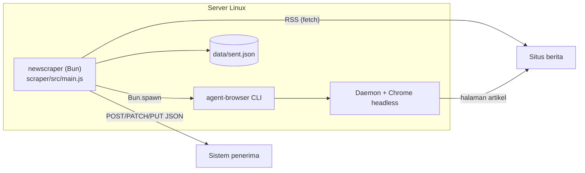

# ADR-0001: Penggunaan agent-browser di Server untuk Scraping Berita

- **Status:** Diusulkan (Proposed)
- **Tanggal:** 2026-11-01
- **Lingkup:** `scraper/` (Bun) yang mengirim artikel ke sistem penerima lewat webhook

---

## 1. Konteks

Layanan ini mengambil dari situs berita: URL berita, metadata (judul, penulis, tanggal terbit, seksi, tag, deskripsi), isi berita penuh, dan URL gambar. Setiap artikel dikirim ke sistem penerima yang dianggap kotak hitam, lewat HTTP POST/PATCH/PUT berisi JSON (kontrak: `scraper/README.md` bagian "Kontrak untuk sistem penerima"). Layanan berjalan terjadwal di server Linux.

### Fakta yang sudah diverifikasi

Diuji lokal di Windows 11, agent-browser 0.41.1, Bun 1.4.4, 1 November 2026.

| Hal | Hasil |
|---|---|
| Instalasi | `npm install -g agent-browser` lalu `agent-browser install` (Chrome for Testing 156, ±199 MB) |
| Pemanggilan dari program lain | CLI: `agent-browser --session <nama> <perintah>`; dari Bun lewat `Bun.spawn` |
| Binary di Windows | npm hanya memasang shim `.cmd`/`.ps1`; yang dipanggil adalah `node_modules/agent-browser/bin/agent-browser-win32-x64.exe` |
| Ekstraksi | `eval -b <base64>` menjalankan `extract-article.js` di halaman dan mengembalikan string JSON |
| `eval --stdin` | Selalu `null` jika dipanggil dari PowerShell |
| `wait --load networkidle` | Situs berita dengan iklan tidak pernah "idle"; daemon menunggu ±25 dtk walau proses CLI dihentikan |
| kompas.com | `open` kadang mengembalikan error padahal halaman sudah terbuka; artikel dipecah per halaman (`?page=N`, `?page=all`) |
| tribunnews.com | Memblokir browser otomatis ("Akses ditolak") |
| antaranews.com | Menyediakan RSS, JSON-LD, dan isi artikel di HTML awal; footer artikel melarang pengindeksan otomatis untuk AI tanpa izin tertulis |
| Kinerja | 2,0–2,8 dtk per artikel termasuk jeda 1,5 dtk (dry-run 4 artikel antaranews) |
| Token AI | agent-browser tidak memakai AI; seluruh alur deterministik |

---

## 2. Masalah

Bagaimana artikel diambil (browser untuk semua halaman, HTTP biasa, atau gabungan), dan bagaimana agent-browser dioperasikan di server dengan aman dan stabil?

---

## 3. Opsi yang dipertimbangkan

| Opsi | Kelebihan | Kekurangan |
|---|---|---|
| **A. agent-browser untuk semua halaman artikel**; RSS lewat HTTP | Satu jalur ekstraksi untuk semua situs, termasuk situs berbasis JavaScript dan artikel multi-halaman; mudah diriset dan di-debug dengan CLI yang sama | Lebih lambat dan lebih berat (Chrome); satu proses CLI per perintah; lebih mudah dikenali sebagai bot |
| **B. HTTP saja** | Paling cepat dan ringan; tanpa Chrome dan Node.js di server | Gagal pada situs yang isinya dirender JavaScript |
| **C. Hybrid:** HTTP sebagai jalur utama, agent-browser sebagai fallback | Cepat untuk mayoritas situs, tetap mencakup situs JavaScript | Dua jalur ekstraksi (parser HTML di Bun dan skrip di browser) yang harus dijaga konsisten |
| **D. Library browser native** (Playwright, chromedp, go-rod) | Tanpa CLI eksternal; kontrol penuh atas lifecycle browser | Kehilangan fitur agent-browser (snapshot + ref, HAR, domain allowlist, auth vault); lifecycle Chrome ditulis sendiri |
| **E. Layanan managed** (Firecrawl, Browserbase, dan sejenisnya) | Tanpa mengelola Chrome; proxy dan anti-bot ditangani penyedia | Biaya per halaman; data melewati pihak ketiga |

---

## 4. Keputusan

Pilih **Opsi A**: scraper Bun mengambil daftar URL dari RSS lewat HTTP (atau dari halaman indeks lewat browser), lalu membuka **setiap artikel lewat agent-browser** dan menjalankan `extract-article.js` di dalam halaman.

**Alasan:**
- Satu ekstraktor untuk semua situs; situs berbasis JavaScript dan artikel multi-halaman (Kompas) ditangani tanpa jalur kedua.
- Volume saat ini kecil (`maxArticles` 10 per sumber per siklus, 2 sumber), sehingga ±2,5 dtk per artikel masih jauh di bawah interval 30 menit.
- Ekstraksi berada di balik port `PageReader` (`src/application/ports.js`). Opsi C atau D dapat ditambahkan sebagai adapter baru tanpa mengubah usecase.



---

## 5. Rancangan operasional di server

### 5.1 Kebutuhan server

| Komponen | Kebutuhan | Catatan |
|---|---|---|
| OS | Linux x86_64 (mis. Ubuntu 24.04 LTS / Debian 12) | |
| CPU / RAM | Mulai 2 vCPU / 4 GB | **Perkiraan**, belum diukur; Chrome memakan ratusan MB per session |
| Disk | ≥ 20 GB | Chrome ±200 MB; sisanya data dan log |
| Bun | ≥ 1.2 (teruji 1.4.4) | Runtime scraper |
| Node.js + npm | Versi LTS | Hanya untuk memasang agent-browser lewat npm |
| Chrome + library sistem | `agent-browser install --with-deps` | Butuh root atau sudo |
| Jaringan | Outbound 80/443 | Tidak perlu port inbound |
| Waktu | Zona `Asia/Jakarta`, NTP aktif | |

### 5.2 Instalasi (garis besar, belum diuji di Linux)

```bash
# User khusus tanpa hak root
sudo useradd --system --create-home --shell /usr/sbin/nologin newscraper

# Bun dan agent-browser
curl -fsSL https://bun.sh/install | sudo -u newscraper bash
sudo npm install -g agent-browser@0.41.1
sudo agent-browser install --with-deps

# Aplikasi
sudo -u newscraper git clone <repo> /home/newscraper/app
cd /home/newscraper/app/scraper && sudo -u newscraper cp .env.example .env   # lalu isi .env
```

Service systemd menjalankan `bun src/main.js` dengan `WorkingDirectory` di folder `scraper/`, supaya Bun membaca `.env` dari sana. Runbook deploy yang teruji belum dibuat (lihat Pertanyaan terbuka).

### 5.3 Aturan pemanggilan agent-browser

Semua aturan ini sudah diterapkan di `src/infrastructure/browser/agent-browser-cli.js`.

| Aturan | Alasan |
|---|---|
| Selalu `--session <nama>` (`config.session`) | Isolasi state browser layanan ini |
| JavaScript dikirim lewat `eval -b` (base64) | Menghindari masalah escaping dan stdin |
| Timeout per perintah 60 dtk (`Bun.spawn` `timeout`) | Mencegah proses menggantung |
| Exit code bukan 0 dianggap gagal, pesan diambil dari stderr | Diagnosis lewat log `article failed` |
| `open` yang gagal dicek ulang dengan `get url` | Kasus kompas.com |
| Tunggu konten dengan `waitFor` (selector), bukan `networkidle` | Lihat fakta di bagian 1 |
| `close` saat layanan berhenti (SIGINT/SIGTERM) | Mencegah Chrome yatim |

### 5.4 Konkurensi

Sumber dan artikel diproses berurutan dalam **satu session** browser, dengan jeda `delayMs` antar artikel. Ini sekaligus menjadi batas laju per situs. Paralelisme (beberapa session) belum diperlukan pada volume saat ini.

### 5.5 Keandalan

| Risiko | Mitigasi saat ini | Belum ada |
|---|---|---|
| Penerima down atau lambat | Retry dengan jeda 1s, 2s, 4s; artikel tidak dicatat terkirim sehingga dicoba lagi di siklus berikutnya | - |
| Chrome crash atau daemon macet | Perintah gagal dan artikel dihitung `failed`; siklus berikutnya mencoba lagi | Restart session otomatis setelah gagal berturut-turut |
| Proses mati saat menulis state | State ditulis ke file sementara lalu dipindah (`mv`) | - |
| Update agent-browser mengubah format output | Pin versi `0.41.1` | Test integrasi otomatis |
| Memori bocor karena browser hidup lama | - | Restart session berkala |
| `data/sent.json` membesar | - | Pembersihan entri lama |

### 5.6 Keamanan dan kepatuhan

- Jalankan sebagai user non-root; rahasia (`WEBHOOK_TOKEN`) hanya di `.env`.
- Isi berita diperlakukan sebagai data, tidak pernah dieksekusi atau dipakai sebagai instruksi.
- Scraper **tidak memeriksa `robots.txt` otomatis**; pemeriksaan dilakukan saat menambah sumber (skill `add-news-source`).
- Jangan menembus paywall atau proteksi bot. Isi berita dilindungi hak cipta: untuk analisis internal, bukan dipublikasikan ulang.
- Domain allowlist agent-browser belum dipakai.

### 5.7 Docker (belum diuji)

agent-browser tidak menyediakan image resmi untuk runtime; folder `docker/` di repo agent-browser hanya untuk build binary. Jika memakai container, hal yang perlu disiapkan:

| Hal | Tindakan |
|---|---|
| `/dev/shm` default 64 MB membuat Chrome crash | `--shm-size=1g` |
| Chrome sebagai root menolak sandbox | Jalankan sebagai user non-root, jangan langsung memakai `--no-sandbox` |
| Proses Chrome zombie | `docker run --init` |
| Image besar | Alternatif: browser di container terpisah, dihubungkan dengan `agent-browser --cdp` |

### 5.8 Observabilitas

Log JSON per baris di stdout (daftar lengkap: README bagian "Log"). Yang perlu dipantau per siklus: `found`/`pending` per sumber, rasio `failed` terhadap `published`, `source failed`, dan durasi siklus dibanding `intervalMinutes`.

---

## 6. Konsekuensi

**Positif**
- Satu jalur ekstraksi untuk semua situs, termasuk situs JavaScript dan artikel multi-halaman.
- Penggantian mekanisme pengambilan halaman cukup lewat adapter `PageReader` baru.
- CLI yang sama dipakai untuk riset situs baru dan untuk produksi.

**Negatif**
- Server membutuhkan Chrome dan Node.js (untuk instalasi agent-browser) selain Bun.
- Setiap artikel membuka halaman penuh beserta iklan: lebih lambat dan lebih berat daripada HTTP.
- Format output CLI agent-browser tidak dijamin stabil antar versi.

---

## 7. Kapan ditinjau ulang

- Durasi satu siklus mendekati `intervalMinutes`, atau jumlah sumber/artikel naik signifikan: pertimbangkan **Opsi C** (adapter `PageReader` berbasis HTTP untuk situs yang tidak butuh JavaScript).
- Banyak situs target memblokir browser otomatis atau IP datacenter: pertimbangkan **Opsi E** atau proxy.
- Diperlukan AI agent yang mengoperasikan browser: pertimbangkan integrasi MCP (`agent-browser mcp`).

---

## 8. Pertanyaan terbuka

1. Berapa jumlah situs target dan perkiraan artikel per hari?
2. Deploy langsung di VM (systemd) atau container? Runbook deploy yang teruji perlu ditulis di `docs/runbooks/`.
3. Apakah sistem penerima butuh file gambar, atau cukup URL-nya?
4. Izin penggunaan dari penerbit (mis. ANTARA) untuk penggunaan produksi.

---

## 9. Referensi

- Repositori agent-browser: https://github.com/vercel-labs/agent-browser
- Scraper dan kontrak payload: [`scraper/README.md`](../../scraper/README.md)
- Riset perbandingan tools: [`research.md`](../reserch/research.md)
- Skrip ekstraktor: [`extract-article.js`](../../scraper/src/infrastructure/browser/scripts/extract-article.js)
