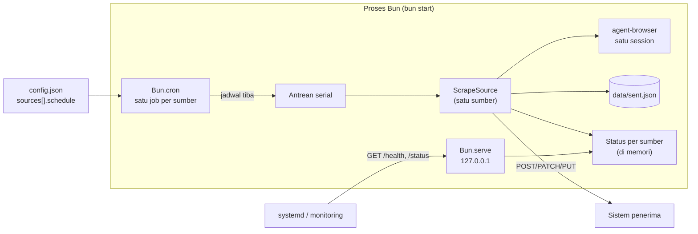
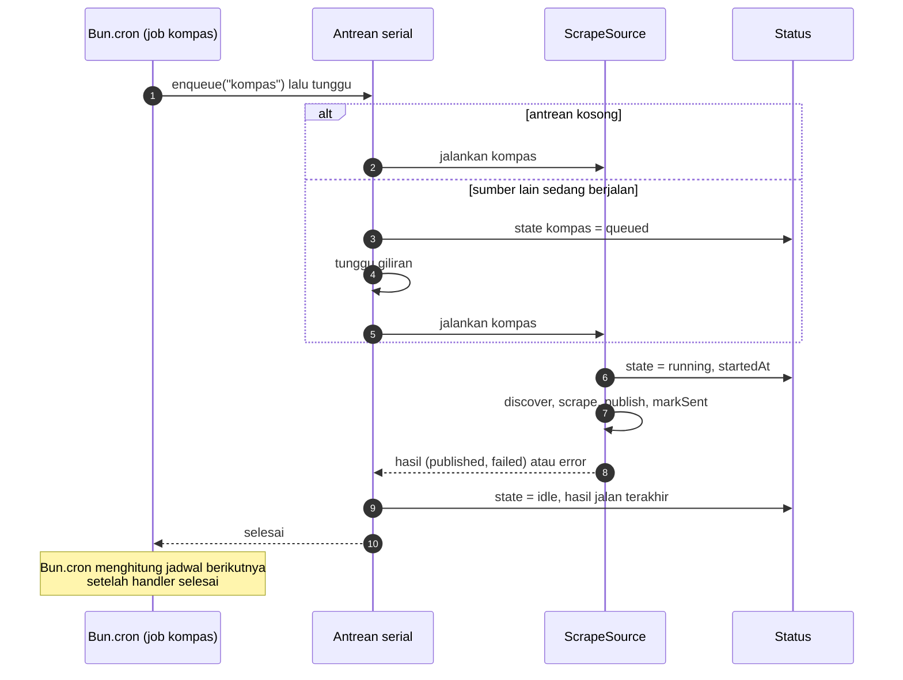
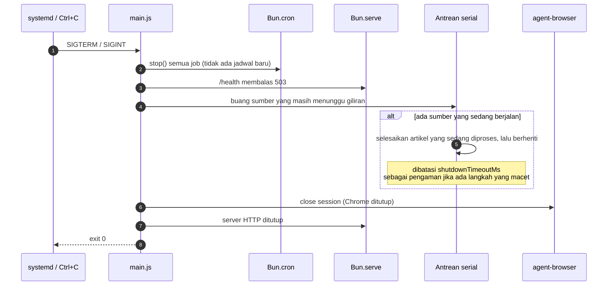
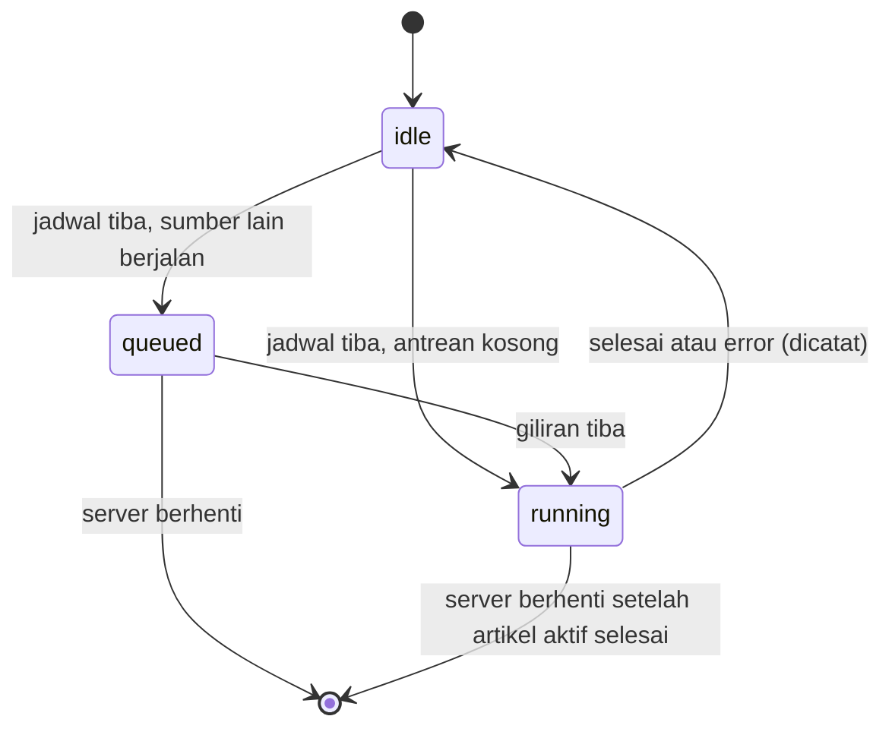

# ADR-0002: Scraper sebagai Server dengan Jadwal Cron per Sumber

- **Status:** Diterima (Accepted), 2026-11-02
- **Tanggal:** 2026-11-02
- **Lingkup:** `scraper/` (Bun)
- **Terkait:** melengkapi [ADR-0001](0001-penggunaan-agent-browser-di-server.md) (cara artikel diambil); ADR ini mengatur **kapan** dan **bagaimana** setiap sumber dijalankan

---

## 1. Konteks

Scraper berjalan sebagai satu loop (`src/main.js`): setiap `intervalMinutes` (satu nilai global), semua sumber dijalankan berurutan. Tidak ada cara memberi jadwal berbeda per sumber, dan tidak ada cara melihat dari luar apakah layanan sehat atau kapan sumber terakhir berhasil.

Kebutuhan baru:

- Scraper berjalan sebagai **server tersendiri** yang hidup terus.
- Setiap sumber punya **jadwal cron sendiri** di `config.json` (mis. antaranews tiap 15 menit, kompas tiap jam).
- Server mengeksekusi scraping sebuah sumber tepat ketika jadwalnya tiba.

### Fakta yang sudah diverifikasi

Diuji dengan Bun 1.4.4 di Windows 11, 2 November 2026 (dokumentasi: https://bun.com/docs/runtime/cron).

| Hal | Hasil |
|---|---|
| `Bun.cron(schedule, handler, { tz })` | Penjadwal di dalam proses; mengembalikan `CronJob` dengan `stop()`, `ref()`, `unref()` |
| Zona waktu | `0 7 * * *` dengan `{ tz: 'Asia/Jakarta' }` jatuh pada 07:00 WIB (00:00 UTC) |
| `Bun.cron.parse(expr, from, { tz })` | Mengembalikan waktu jalan berikutnya; ekspresi tidak valid melempar `Invalid cron expression` |
| Sintaks | 5 field (menit, jam, tanggal, bulan, hari) dan nickname `@hourly`, `@daily`, dst. Tanpa field detik |
| Tumpukan pemanggilan | Menurut dokumentasi, jadwal berikutnya dihitung setelah handler (dan Promise-nya) selesai, sehingga **satu job** tidak pernah berjalan bertumpuk. Job yang **berbeda** tetap bisa berjalan bersamaan |
| Error di handler | Promise yang ditolak memicu `unhandledRejection`; tanpa listener, proses keluar dengan kode 1 |
| Bentuk lain `Bun.cron(path, schedule, title)` | Mendaftarkan job ke crontab/launchd/Task Scheduler; setiap jalan adalah proses baru |

Batasan dari kode saat ini: semua sumber memakai **satu session agent-browser** (`config.session`) dan **satu file state** (`data/sent.json`). Dua sumber yang berjalan bersamaan akan saling menimpa halaman yang sedang dibuka di session yang sama.

---

## 2. Masalah

Bagaimana menjadwalkan setiap sumber secara terpisah di dalam satu layanan Bun yang hidup terus, tanpa dua scraping saling bertabrakan di session browser yang sama, dan bagaimana operator mengetahui kondisi layanan?

---

## 3. Opsi yang dipertimbangkan

### Penjadwal

| Opsi | Kelebihan | Kekurangan |
|---|---|---|
| **A. `Bun.cron` di dalam proses** | Bawaan Bun (tanpa dependency); mendukung zona waktu; satu job tidak bertumpuk; state (antrean, status) bisa dibagi antar job | Jadwal hilang jika proses mati (dipulihkan saat proses dijalankan ulang oleh systemd) |
| **B. Cron OS** (crontab / systemd timer / `Bun.cron(path, ...)`) memanggil `bun src/main.js --once --source <nama>` | Bertahan walau proses mati; tiap jalan proses bersih | Konfigurasi jadwal pindah ke OS, terpisah dari `config.json`; tiap jalan meluncurkan Chrome dari awal; tidak ada proses yang hidup untuk melaporkan status; perlu kunci antar-proses agar dua sumber tidak memakai session yang sama |
| **C. Loop `setInterval` per sumber** | Sederhana | Hanya interval, bukan jadwal kalender (mis. "jam 07:00 WIB"); tanpa zona waktu |
| **D. Library cron dari npm** | Fitur lengkap | Melanggar aturan project: tanpa dependency npm |

### Eksekusi saat beberapa jadwal jatuh bersamaan

| Opsi | Kelebihan | Kekurangan |
|---|---|---|
| **E. Antrean tunggal (serial)** dengan satu session browser | Tidak ada tabrakan session dan file state; pemakaian RAM tetap (satu Chrome) | Sumber yang lama menunda sumber lain |
| **F. Paralel, satu session per sumber** | Sumber tidak saling menunggu | Satu Chrome per sumber (RAM naik linear); penulisan `sent.json` perlu dikunci |

### Visibilitas

| Opsi | Kelebihan | Kekurangan |
|---|---|---|
| **G. Endpoint HTTP status** (`Bun.serve`) | Health check untuk systemd/Docker/monitoring; status per sumber bisa dilihat tanpa membaca log | Port tambahan yang harus diamankan |
| **H. Log saja** | Tanpa permukaan jaringan | Status terakhir dan jadwal berikutnya harus disimpulkan dari log |

---

## 4. Keputusan

Pilih **A + E + G**:

1. **Mode server** adalah perilaku default `bun start`: proses hidup terus, menjadwalkan setiap sumber dengan `Bun.cron` (zona waktu dari config), dan membuka endpoint HTTP status.
2. **Jadwal per sumber** di `sources[].schedule` (ekspresi cron 5 field atau nickname). Semua jadwal divalidasi dengan `Bun.cron.parse` saat start; satu jadwal tidak valid membuat server gagal start dengan pesan yang menyebut nama sumbernya.
3. **Antrean tunggal:** handler cron memasukkan sumber ke antrean lalu menunggu sampai sumber itu selesai. Antrean menjalankan satu sumber pada satu waktu dengan satu session browser. Karena handler menunggu, `Bun.cron` tidak menjadwalkan ulang sumber yang sama sebelum jalannya selesai; jadwal yang terlewat selama itu tidak dikejar.
4. **Endpoint HTTP** (`Bun.serve`), default hanya di `127.0.0.1`:
   - `GET /health`: `200` saat berjalan normal, `503` saat sedang berhenti.
   - `GET /status`: per sumber: `schedule`, `nextRunAt`, `state` (`idle` / `queued` / `running`), dan hasil jalan terakhir (`startedAt`, `finishedAt`, `published`, `failed`, `error`).
5. **Saat server start, tidak ada sumber yang langsung dijalankan;** setiap sumber menunggu jadwal berikutnya.
6. **Pemicu hanya cron.** Tidak ada endpoint HTTP untuk menjalankan sumber; pemicu manual memakai mode sekali jalan dari CLI.
7. **Satu zona waktu global** (`timezone`) untuk semua jadwal.
8. **Mode sekali jalan tetap ada** untuk uji dan operasi manual: `--once` menjalankan semua sumber satu kali lalu keluar, `--source <nama>` membatasi ke satu sumber. `--dry-run` tetap berlaku di kedua mode.
9. **Penghentian (graceful shutdown):** saat `SIGINT`/`SIGTERM`, semua `CronJob` dihentikan, `/health` membalas `503`, antrean yang belum mulai dibuang, dan sumber yang sedang berjalan berhenti setelah artikel yang sedang diproses selesai. Batas tunggu `shutdownTimeoutMs` (default 60 detik, di bawah default `TimeoutStopSec` systemd 90 detik) hanya pengaman jika ada langkah yang macet; setelah itu session browser ditutup dan proses keluar. Artikel yang terputus tidak dicatat terkirim, sehingga dicoba lagi pada jadwal berikutnya.
10. **Error di dalam job** ditangkap di antrean dan dicatat sebagai hasil jalan (`error`); tidak pernah menjadi `unhandledRejection`, sehingga satu sumber yang gagal tidak mematikan server.

**Alasan:** `Bun.cron` memenuhi jadwal kalender dengan zona waktu tanpa dependency, dan proses yang hidup terus diperlukan untuk menyimpan antrean serta status. Antrean serial mempertahankan jaminan yang sudah ada (satu session browser, satu penulis `sent.json`) dengan perubahan terkecil.



### Alur saat jadwal tiba



### Graceful shutdown

Server berjalan terus; alur ini hanya terjadi saat server sengaja dihentikan (deploy, restart, `systemctl stop`, Ctrl+C).



Artikel yang belum selesai saat batas waktu tercapai tidak dicatat terkirim, sehingga dicoba lagi pada jadwal berikutnya; tidak ada artikel yang hilang.

### Status satu sumber



---

## 5. Perubahan konfigurasi

Perubahan langsung (tanpa masa transisi): `intervalMinutes` dihapus dari config.

```json
{
  "timezone": "Asia/Jakarta",
  "server": { "host": "127.0.0.1", "port": 3000 },
  "sources": [
    { "name": "antaranews", "schedule": "*/15 * * * *", "discovery": { "type": "rss", "url": "..." } },
    { "name": "kompas", "schedule": "0 * * * *", "discovery": { "type": "index", "url": "..." } }
  ]
}
```

| Field | Default | Keterangan |
|---|---|---|
| `timezone` | `Asia/Jakarta` | Zona waktu IANA untuk semua jadwal |
| `server.host` | `127.0.0.1` | Alamat endpoint status; `0.0.0.0` hanya jika dilindungi firewall/reverse proxy |
| `server.port` | `3000` | Port endpoint status; bisa ditimpa env `PORT` |
| `shutdownTimeoutMs` | `60000` | Batas tunggu artikel yang sedang diproses saat server dihentikan |
| `sources[].schedule` | wajib | Ekspresi cron 5 field atau nickname (`@hourly`, `@daily`, ...) |

Field sumber lain (`discovery`, `pattern`, `waitFor`, `minWords`, `maxArticles`, `preferAllPage`, `maxPages`) tidak berubah.

---

## 6. Dampak pada kode

| Lapisan | Perubahan |
|---|---|
| `domain/source.js` | `schedule` wajib; divalidasi saat `createSource` dengan `Bun.cron.parse` |
| `application/` | `ScrapeSources` dipecah: usecase `ScrapeSource` (satu sumber) dan antrean serial (`SourceRunQueue`) yang mencatat status per sumber |
| `application/ports.js` | Port baru `Scheduler` (`schedule(source, handler)`, `stopAll()`, `nextRun(source)`) |
| `infrastructure/` | `scheduling/bun-cron-scheduler.js` (adapter `Bun.cron`), `http/status-server.js` (`Bun.serve`) |
| `main.js` | Memilih mode: server (default) atau sekali jalan (`--once`, `--source`); merakit scheduler, antrean, dan server HTTP |
| `config/load-config.js` | Membaca `timezone`, `server`, env `PORT`; menolak `intervalMinutes` |
| Test | Antrean serial dan status diuji dengan scheduler palsu, tanpa menunggu waktu nyata |
| Dokumen | `scraper/README.md` (Menjalankan, Konfigurasi, Log, endpoint), `.env.example` (`PORT`), ADR-0001 §5.4 |

Log baru: `scheduled` (`source`, `schedule`, `nextRunAt`), `run queued`, `run started`, `run finished` (`published`, `failed`, `durationMs`), `run failed` (`error`), `server listening` (`host`, `port`).

---

## 7. Konsekuensi

**Positif**
- Jadwal setiap sumber diatur di satu tempat (`config.json`) dan mengikuti zona waktu yang jelas.
- Tetap satu Chrome dan satu penulis `sent.json`; tidak ada kunci tambahan.
- Kondisi layanan bisa diperiksa lewat `/health` dan `/status`.
- Satu sumber yang gagal tidak menghentikan server maupun sumber lain.

**Negatif**
- Sumber yang lama menunda sumber lain di antrean.
- Status jalan terakhir disimpan di memori, sehingga hilang saat proses restart; riwayat panjang tetap harus dibaca dari log.
- Jadwal yang jatuh saat server mati tidak dijalankan susulan, dan setelah server start (mis. sesudah deploy) setiap sumber baru berjalan pada jadwal berikutnya.
- Butuh Bun dengan `Bun.cron`; versi minimum tidak disebut di dokumentasi, sehingga `engines.bun` dinaikkan ke versi teruji `>=1.4.4`.
- Port HTTP tambahan yang harus dibatasi ke localhost atau dilindungi.

---

## 8. Kapan ditinjau ulang

- Waktu tunggu di antrean (`queued`) sering melebihi jarak antar jadwal sebuah sumber: pertimbangkan **Opsi F** (session per sumber).
- Layanan perlu lebih dari satu instance (ketersediaan tinggi): perlu antrean atau kunci terdistribusi agar satu sumber tidak dijalankan dua instance.
- Status jalan perlu bertahan saat restart atau perlu riwayat: simpan status di file atau database.

---

## 9. Pertanyaan terbuka

Tidak ada.
