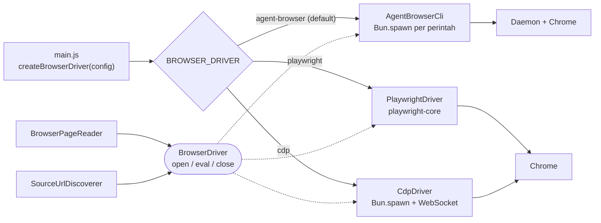

# ADR-0003: Driver Browser yang Bisa Dipilih: agent-browser, Playwright, atau CDP Bun

- **Status:** Diusulkan (Proposed)
- **Tanggal:** 2026-11-02
- **Lingkup:** `scraper/src/infrastructure/browser/`, `scraper/src/main.js`, konfigurasi
- **Terkait:** meninjau ulang Opsi D di [ADR-0001](0001-penggunaan-agent-browser-di-server.md) (library browser native); tidak mengubah antrean serial dan satu session browser dari [ADR-0002](0002-scraper-sebagai-server-dengan-jadwal-cron-per-sumber.md)

---

## 1. Konteks

ADR-0001 memilih agent-browser (CLI) untuk membuka setiap halaman artikel dan halaman indeks. Playwright (Opsi D) waktu itu tidak dipilih. Ada dugaan bahwa Playwright lebih cocok untuk scraper ini, karena agent-browser dirancang untuk AI agent sementara scraper ini deterministik. Opsi ketiga juga dipertimbangkan: mengendalikan Chrome langsung lewat Chrome DevTools Protocol (CDP) dengan API bawaan Bun, tanpa dependency. Pilihan di antara ketiganya diputuskan dari pengukuran, bukan dari kesan.

### Pemakaian browser di kode saat ini (terverifikasi)

| Pemakai | Yang dipanggil | Lokasi |
|---|---|---|
| `BrowserPageReader` (port `PageReader`) | `open(url, waitFor)`, lalu `eval(extract-article.js)` | `src/infrastructure/browser/browser-page-reader.js` |
| `SourceUrlDiscoverer` (discovery `index`) | `open(url)`, lalu `eval('[...document.querySelectorAll("a[href]")]...')` | `src/infrastructure/discovery/source-url-discoverer.js` |
| `main.js` (runOnce, graceful shutdown) | `close()` | `src/main.js` |

Dari agent-browser, scraper hanya memakai perintah `open`, `get url`, `wait <selector>`, `eval -b`, dan `close` (`agent-browser-cli.js`). Fitur yang ditujukan untuk AI agent (snapshot + ref, MCP, auth vault) **tidak dipakai**, dan agent-browser tidak memakai token AI. Jadi perbedaan yang relevan bukan "untuk AI atau bukan", melainkan arsitektur dan biaya perawatannya.

### Tiga kandidat driver

| | agent-browser | Playwright | CDP Bun |
|---|---|---|---|
| Cara memanggil | Satu proses CLI per perintah (`Bun.spawn`); daemon menyimpan Chrome | Library di dalam proses Bun; satu koneksi ke Chrome | `Bun.spawn` Chrome dengan `--remote-debugging-port`, lalu `WebSocket` bawaan Bun ke CDP |
| Kode yang dirawat sendiri | Pembungkus CLI (`agent-browser-cli.js`) | Pembungkus tipis di atas API Playwright | Klien CDP: korelasi request/respons, event, timeout, lifecycle Chrome |
| Kontrol request | Tidak dipakai | `page.route` | `Fetch.enable` / `Network.setBlockedURLs` (ditulis sendiri) |
| Kondisi tunggu | `wait <selector>`; `networkidle` tidak bisa dipakai | `waitUntil: 'domcontentloaded'` + `waitForSelector` | Event `Page.domContentEventFired` + polling selector |
| Dependency di `package.json` | Tidak ada | `playwright-core` | Tidak ada |
| Butuh npm/Node.js di server | Ya, untuk `npm install -g agent-browser` | Tidak; `bun add` cukup | Tidak |
| Sumber Chrome | `agent-browser install` | Chromium Playwright atau `executablePath` ke Chrome lain | Chrome apa pun (paket OS, Chrome for Testing) |
| Dukungan Bun | Proses biasa, terbukti jalan | Tidak ada dukungan resmi; jalan di Windows dan Linux (spike) | Hanya memakai API Bun; jalan di Windows dan Linux (spike) |
| Sandbox Chrome | Belum diperiksa | Dimatikan secara default (`--no-sandbox`); dinyalakan dengan `chromiumSandbox: true` | Mengikuti argumen yang diberikan driver |
| Kestabilan antarmuka | Format output CLI tidak dijamin stabil (ADR-0001) | API publik bersemver | Protokol CDP; domain `Page`, `Runtime`, `Target` yang dipakai sudah stabil, perubahan Chrome tetap bisa memengaruhi |

### Hasil spike

Diuji 2 November 2026 di Windows 11, Bun 1.4.4, Chrome for Testing 156.0.8078.80 milik agent-browser, `playwright-core` 1.64.1, agent-browser 0.41.1. Semua halaman uji disajikan lokal oleh `Bun.serve`; tidak ada situs berita yang diakses. Skrip spike tidak masuk repo.

| Hal | Playwright | CDP Bun (±120 baris) |
|---|---|---|
| Peluncuran Chrome | `chromium.launch()` lewat pipe: ±0,9 dtk pertama, ±0,2–0,3 dtk berikutnya | `Bun.spawn` + baca `DevTools listening on ws://...` dari stderr: ±0,5 dtk |
| `eval(extract-article.js)` | `page.evaluate` mengembalikan string JSON sesuai bentuk yang diharapkan `BrowserPageReader` | `Runtime.evaluate` (`returnByValue`) mengembalikan string JSON yang sama |
| Tunggu konten yang dirender JavaScript 0,8 dtk setelah load | `waitForSelector` jalan | Polling `document.querySelector` tiap 100 ms jalan (±0,85 dtk) |
| Redirect 302 | Tidak diuji | `location.href` berakhir di URL tujuan |
| Alamat gagal dibuka | Melempar `net::ERR_...` | `Page.navigate` mengembalikan `errorText`, diubah menjadi error |
| Error di skrip `eval` | Tidak diuji | `exceptionDetails` diubah menjadi error |
| Chrome crash (`Browser.crash`) | Event `disconnected`; perintah berikutnya error; peluncuran ulang berhasil | WebSocket tertutup, proses Chrome keluar; peluncuran ulang berhasil |
| `close()` dua kali | Tidak melempar error | Awalnya **menggantung**: request yang menunggu tidak dibatalkan saat WebSocket tertutup. Setelah diperbaiki (tolak semua request saat `onclose`), jalan |
| Kecepatan, 20 halaman lokal kecil, `open` + `eval` ekstraktor | Median 15 ms, maks 30 ms | Median 14 ms, maks 27–29 ms |
| agent-browser pada uji yang sama | Median 248 ms, maks 4.535 ms | |

Catatan pembacaan:

- Angka kecepatan hanya menunjukkan **overhead driver** pada halaman lokal tanpa iklan dan tanpa jaringan, bukan waktu nyata di situs berita.
- Satu kali `goto` pertama Playwright tercatat 5,5 dtk pada percobaan awal dan tidak terulang pada tiga percobaan berikutnya (0,15–0,28 dtk); penyebabnya belum diketahui.
- Bug `close()` pada CDP Bun adalah contoh jenis kasus tepi yang sudah ditangani Playwright tetapi harus ditulis dan diuji sendiri pada driver CDP.

### Hasil spike di Linux (Docker)

Diuji 2 November 2026 dengan Docker Desktop 29.5.3 di laptop yang sama: image `oven/bun:1.4.4-debian` (Debian 13.7, kernel WSL2 6.18), Chrome for Testing 156.0.8078.80 linux64, `playwright-core` 1.64.1. Container dijalankan dengan `--init --shm-size=1g` sebagai user non-root `bun`. Skrip dan halaman uji sama dengan spike Windows; agent-browser tidak diuji di sini.

| Hal | Playwright | CDP Bun |
|---|---|---|
| Peluncuran Chrome | `chromium.launch()` jalan, ±0,1 dtk | **Gagal** tanpa `--no-sandbox`: Chrome berhenti dengan `No usable sandbox!`. Dengan `--no-sandbox`: jalan, ±0,2 dtk |
| Ekstraksi, tunggu selector, alamat gagal, error di skrip, redirect | Sama dengan Windows | Sama dengan Windows (dengan `--no-sandbox`) |
| `close()` dua kali | Tidak melempar error | Tidak melempar dan tidak menggantung |
| Kecepatan, 20 halaman lokal | Median 15 ms, maks 21 ms | Median 14 ms, maks 18 ms |
| Crash lewat `Browser.crash` (CDP) | Event `disconnected` tidak terpicu dalam 5 dtk, tetapi `isConnected()` `false` | WebSocket tidak tertutup dan Chrome tetap hidup. **Di Linux, perintah ini tidak bisa dipakai untuk mensimulasikan crash** |
| Crash lewat `kill -9` ke proses utama Chrome | Event `disconnected` terpicu; `goto` berikutnya error; peluncuran ulang berhasil | WebSocket tertutup, proses keluar (kode 137), tidak ada proses Chrome tersisa |
| `connectOverCDP` (Opsi E) | Gagal karena Chrome yang diluncurkan sendiri tanpa `--no-sandbox` tidak mau jalan (penyebab yang sama dengan CDP Bun) | - |

Temuan sandbox:

- Playwright **menambahkan `--no-sandbox` secara default**, terlihat di `playwright-core/lib/coreBundle.js`. Itu sebabnya Playwright langsung jalan di container, sedangkan CDP Bun tidak.
- `chromium.launch({ chromiumSandbox: true })` gagal di container dengan konfigurasi Docker standar.
- Chrome dengan sandbox aktif berhasil jalan setelah container diberi `--security-opt seccomp=unconfined`. Artinya yang menghalangi adalah profil seccomp bawaan Docker, bukan Chrome-nya. `unconfined` hanya dipakai untuk diagnosis, bukan untuk produksi. Keputusan sandbox ada di bagian 4.1.
- Di VM tanpa container (rencana systemd di ADR-0001), sandbox belum diuji.

### Batas keuntungan kecepatan

Hasil terukur ADR-0001: 2,0–2,8 dtk per artikel, **termasuk** jeda `delayMs` 1,5 dtk (dry-run 4 artikel antaranews). Bagian yang bisa dipercepat oleh driver lain hanya sekitar 0,5–1,3 dtk per artikel. Dengan `maxArticles` 10 dan jadwal paling rapat 15 menit, kecepatan driver belum menjadi hambatan. Alasan beralih harus datang dari keandalan, kualitas data, atau biaya operasional, bukan dari kecepatan saja.

---

## 2. Masalah

Bagaimana menyediakan tiga driver browser yang bisa dipilih lewat env tanpa mengubah usecase, lalu membandingkannya secara adil untuk menentukan driver default?

---

## 3. Opsi yang dipertimbangkan

### Titik tukar

| Opsi | Kelebihan | Kekurangan |
|---|---|---|
| **A. Kontrak `BrowserDriver` di infrastruktur** (`open`, `eval`, `close`), satu implementasi per driver | `BrowserPageReader`, `SourceUrlDiscoverer`, dan `extract-article.js` dipakai bersama tanpa diubah; perbandingan adil karena ekstraktornya identik | Perilaku `eval` dan error semua driver harus disamakan persis |
| **B. `PageReader` baru per driver** | Sesuai port yang sudah ada | Discovery `index` tetap memakai agent-browser, jadi dua browser hidup bersamaan; ekstraksi bisa menyimpang antar adapter |
| **C. Langsung ganti agent-browser** dengan salah satu driver | Satu jalur saja | Tanpa pembanding dan tanpa jalan mundur |

### Cara Playwright terhubung ke Chrome

| Opsi | Kelebihan | Kekurangan |
|---|---|---|
| **D. `chromium.launch()`** | Cara standar; lifecycle diatur Playwright | Lifecycle Chrome tidak bisa diatur sendiri |
| **E. `chromium.connectOverCDP()`** ke Chrome yang diluncurkan `Bun.spawn` | Hanya butuh WebSocket; jalan mundur jika D bermasalah di Linux | Lifecycle Chrome ditulis sendiri |

---

## 4. Keputusan

Pilih **Opsi A** dengan tiga implementasi: `AgentBrowserCli` (sudah ada), `PlaywrightDriver` (Opsi D, cadangan E), dan `CdpDriver`. **agent-browser tetap default** sampai hasil perbandingan (bagian 6) memenuhi kriteria peralihan.

### 4.1 Kontrak `BrowserDriver`

Didefinisikan sebagai JSDoc di `src/infrastructure/browser/browser-driver.js`. Kontrak ini milik infrastruktur, bukan port usecase, karena lapisan aplikasi hanya mengenal `PageReader` dan `UrlDiscoverer`.

| Method | Perilaku yang wajib sama di semua driver |
|---|---|
| `open(url, waitFor?)` | Selesai saat DOM siap dibaca (`DOMContentLoaded`) dan, jika `waitFor` diisi, selector itu sudah muncul. Melempar error jika halaman gagal dibuka atau batas waktu 60 dtk terlewati |
| `eval(script)` | Menjalankan `script` (ekspresi JavaScript sebagai teks) di halaman dan mengembalikan nilainya. Error di skrip menjadi error. `extract-article.js` mengembalikan string JSON, jadi `BrowserPageReader` tetap mem-parse satu kali |
| `close()` | Menutup browser; tidak melempar error dan tidak menggantung. Aman dipanggil berkali-kali |

Aturan bersama untuk `PlaywrightDriver` dan `CdpDriver`:

- Satu Chrome dan satu tab yang dipakai ulang, sesuai antrean serial ADR-0002.
- Chrome diluncurkan saat `open` pertama. Jika koneksi terputus (Chrome crash), Chrome diluncurkan ulang pada `open` berikutnya. Mekanisme ini belum ada di driver agent-browser (ADR-0001 bagian 5.5).
- **Sandbox Chrome dimatikan secara default** di kedua driver, mengikuti perilaku bawaan Playwright: Playwright tanpa opsi `chromiumSandbox`, CDP Bun dengan `--no-sandbox`. Alasannya, sandbox tidak bisa jalan di Docker dengan profil seccomp standar (bagian 1), dan perilaku kedua driver harus sama supaya perbandingan adil. Sandbox bisa dinyalakan lewat `CHROME_SANDBOX=1` di lingkungan yang mendukungnya.
- Karena sandbox mati, eksploit di renderer Chrome berjalan dengan hak user proses scraper. Proses **wajib** berjalan sebagai user non-root tanpa akses ke rahasia selain `.env` miliknya, dan sebaiknya di dalam container (ADR-0001 bagian 5.6 dan 5.7).
- Tanpa pemblokiran request secara default, supaya perbandingan adil. Pemblokiran iklan/media diuji sebagai varian terpisah (bagian 6).
- User agent bawaan tidak diganti. Driver tidak dipakai untuk menyamarkan bot atau menembus proteksi (tribunnews tetap tidak di-scrape).

Rincian `CdpDriver`:

| Bagian | Cara |
|---|---|
| Peluncuran | `Bun.spawn` Chrome dengan `--headless=new --remote-debugging-port=0 --user-data-dir=<folder sementara>`; alamat WebSocket dibaca dari stderr |
| Tab | `Target.createTarget` + `Target.attachToTarget` (`flatten: true`), lalu `Page.enable` |
| `open` | `Page.navigate`; `errorText` menjadi error; tunggu `Page.domContentEventFired` dengan batas waktu; `waitFor` lewat polling `Runtime.evaluate` |
| `eval` | `Runtime.evaluate` dengan `returnByValue` dan `awaitPromise` |
| Koneksi putus | Semua request yang sedang menunggu ditolak; perintah baru langsung error |
| `close` | `Browser.close`, tunggu proses keluar, hapus folder profil sementara |

### 4.2 Isolasi pengganti sandbox Chrome

Sandbox Chrome membatasi apa yang bisa dilakukan kode dari halaman yang berhasil mengeksploitasi renderer. Tanpa sandbox, batas itu dipindah ke lapisan di luar Chrome. Tujuannya: eksploit di halaman berita tidak mendapat rahasia (`WEBHOOK_TOKEN`), tidak bisa mengubah kode atau state, dan tidak bisa menjangkau jaringan internal.

| Lapisan | Cara | Status |
|---|---|---|
| User non-root | `USER bun` di image | Terverifikasi (spike) |
| Tanpa capability Linux | `--cap-drop ALL` (`CapEff` 0) | Terverifikasi: Chrome `--no-sandbox` jalan di Playwright dan CDP Bun |
| Tanpa eskalasi hak | `--security-opt no-new-privileges` (`NoNewPrivs` 1) | Terverifikasi: idem |
| Filesystem read-only | `--read-only` + `--tmpfs /tmp` (profil Chrome dan file sementara di `/tmp`) | Terverifikasi: idem; menulis ke `/home/bun` ditolak |
| Profil seccomp bawaan Docker | Tetap aktif; tidak memakai `seccomp=unconfined` | Terverifikasi: `--no-sandbox` jalan dengan profil bawaan |
| Batas sumber daya | `--memory 1g --pids-limit 1024` | Terverifikasi dengan catatan: satu Chrome ±160 thread, dan `--pids-limit` menghitung thread. Dengan batas 256, peluncuran ulang gagal selama Chrome lama masih hidup |
| Profil sementara | `--user-data-dir` baru di `/tmp` setiap peluncuran, dihapus saat `close` | Rancangan (bagian 4.1) |
| **Browser di container terpisah** | Chrome jalan di container sendiri tanpa `.env`, tanpa `data/`, dan tanpa kode scraper. Scraper terhubung lewat CDP (`CdpDriver` ke alamat WebSocket; Playwright lewat `connectOverCDP`). Port CDP hanya ada di jaringan Docker internal, tidak pernah dipublikasikan ke host, karena siapa pun yang mencapai port itu menguasai browser | Belum diuji |
| Batas jaringan keluar | Container browser hanya keluar ke 80/443 internet; alamat privat dan metadata cloud (`169.254.169.254`) diblokir | Belum diuji; bergantung pada firewall host atau jaringan Docker |
| Kurangi permukaan serangan | Blokir request ke jaringan iklan (sumber umum malvertising), mis. `Network.setBlockedURLs` | Belum diuji; dampaknya ke ekstraksi diukur di varian blokir request (bagian 6) |
| Chrome tetap mutakhir | Versi Chrome di-pin untuk kestabilan, tetapi diperbarui terjadwal mengikuti rilis keamanan | Prosedur belum dibuat |

Dengan container terpisah, eksploit renderer hanya mendapat container browser: tanpa rahasia, tanpa hak tulis selain `/tmp`, dan hilang saat container dimulai ulang. Ini tidak setara dengan sandbox Chrome yang ditambah container, tetapi membatasi dampaknya. Jika suatu saat sandbox dibutuhkan, `CHROME_SANDBOX=1` bersama profil seccomp yang mengizinkan user namespace tetap menjadi pilihan.

### 4.3 Pemilihan driver

| Sumber nilai | Nama | Nilai | Default |
|---|---|---|---|
| Env (menimpa config) | `BROWSER_DRIVER` | `agent-browser`, `playwright`, atau `cdp` | `agent-browser` |
| `config.json` | `browserDriver` | sama | `agent-browser` |
| Env, untuk `playwright` dan `cdp` | `CHROME_PATH` | path ke Chrome/Chromium | Playwright: Chromium miliknya; CDP: wajib diisi |
| Env, untuk `playwright` dan `cdp` | `CHROME_SANDBOX` | `1` menyalakan sandbox Chrome | kosong (sandbox mati, `--no-sandbox`) |

Nilai lain ditolak oleh `loadConfig` dengan pesan error, mengikuti pola validasi yang sudah ada. `config.session` tetap hanya berlaku untuk agent-browser.

### 4.4 Wiring

`main.js` mengganti `new AgentBrowserCli(...)` dengan satu factory `createBrowserDriver(config)`. Modul Playwright di-import secara dinamis (`await import(...)`) hanya saat `playwright` dipilih, sehingga driver lain tidak butuh paket Playwright terpasang.

### 4.5 Pengecualian aturan dependency untuk Playwright

Aturan project: tanpa dependency npm (`.claude/CLAUDE.md`). `PlaywrightDriver` adalah pengecualian, **disetujui pemilik project pada 2026-11-02**. Paket dipasang dengan `bun add` (tanpa npm atau Node.js). Batasannya:

- Hanya `playwright-core` (tanpa unduhan browser otomatis saat install), versi di-pin persis di `package.json`.
- Hanya di-import oleh `playwright-driver.js`; domain dan aplikasi tetap tanpa dependency.
- Kode lain tetap memakai API Bun; larangan `node:*` tidak berubah.

`CdpDriver` tidak membutuhkan pengecualian apa pun. Aturan di CLAUDE.md diperbarui saat `playwright-core` benar-benar masuk `package.json` (langkah 4).

---

## 5. Rencana pelaksanaan

| Langkah | Isi | Selesai jika |
|---|---|---|
| 1. Spike di Linux | Skrip spike yang sama untuk Playwright dan CDP Bun | **Selesai** di Docker (bagian 1), dengan sandbox mati sesuai bagian 4.1 |
| 2. Kontrak + factory | `browser-driver.js`, `createBrowserDriver`, validasi `browserDriver` di `loadConfig` | **Selesai** 2026-11-02 |
| 3. `CdpDriver` | Implementasi bagian 4.1, dengan klien CDP yang bisa diuji tanpa Chrome (WebSocket tiruan dari `Bun.serve`) | **Selesai** 2026-11-02: unit test lolos; dry-run antaranews menghasilkan payload identik dengan agent-browser |
| 4. `PlaywrightDriver` | Implementasi bagian 4.1 | **Selesai** 2026-11-02: idem |
| 5. Alat perbandingan | `tools/compare-drivers.js` (bagian 6) | **Selesai** 2026-11-02. Hasil pertama: [benchmark-driver-browser-2026-11-02.md](../reserch/benchmark-driver-browser-2026-11-02.md); kriteria 3 (isi identik ≥ 95%) tidak terpenuhi karena perbedaan kondisi tunggu, kriteria 4 (uji 24 jam) belum dijalankan |
| 6. Dokumen | README (konfigurasi, kebutuhan server), `.env.example`, CLAUDE.md | **Selesai** untuk langkah 2–5 |

`bun test` tetap tanpa browser dan jaringan. Kesetaraan antar driver dibuktikan oleh alat perbandingan, bukan oleh unit test.

---

## 6. Metode perbandingan

### 6.1 Aturan agar adil

- **Daftar URL yang sama.** Ambil URL antaranews dari RSS satu kali, simpan ke file, dan berikan file yang sama ke semua driver. RSS bisa berubah di antara dua kali jalan.
- **Ekstraktor yang sama.** Semua driver menjalankan `extract-article.js` yang sama persis.
- **Chrome yang sama.** Ketiga driver memakai biner Chrome for Testing yang sama (`CHROME_PATH` diarahkan ke Chrome milik agent-browser), supaya yang dibandingkan adalah driver, bukan versi browser.
- **Urutan bergilir.** Driver dijalankan bergiliran (A, B, C, B, C, A, ...) agar cache CDN dan kondisi jaringan tidak menguntungkan salah satunya.
- **Tanpa `delayMs` dalam pengukuran waktu.** Jeda tetap dijalankan untuk sopan santun ke situs, tetapi tidak dihitung.
- **Tanpa mengirim ke webhook dan tanpa menyentuh `data/sent.json`.**
- **Sumber yang dipakai: antaranews saja**, volume kecil (mis. 20 artikel × 3 putaran per driver). Kompas tidak dipakai sebelum izin dari PT Kompas Cyber Media dikonfirmasi. tribunnews tidak dipakai karena memblokir browser otomatis, dan perbandingan ini bukan uji menembus proteksi.

### 6.2 Metrik

| Metrik | Cara mengukur |
|---|---|
| Waktu per artikel (median, p95) | Dari sebelum `open` sampai `eval` selesai |
| Waktu mulai dingin | `open` pertama setelah proses mulai |
| Tingkat keberhasilan | Artikel yang lolos `validateArticle` dibanding total; jenis error dicatat |
| Kesetaraan isi | Per URL: hash `content_text`, selisih `word_count`, jumlah `images`, `title`, `published_at` |
| Puncak RAM | Total proses Bun + Chrome (+ daemon untuk agent-browser). Di Linux dari `/proc`; di Windows ditandai belum diukur jika tidak ada cara andal tanpa dependency |
| Stabilitas jangka panjang | Mode server 24 jam dengan jadwal antaranews 15 menit: jumlah `run failed`, pertumbuhan RAM |
| Biaya instalasi | Ukuran unduhan dan langkah instalasi di server Linux bersih; butuh npm/Node.js atau tidak |
| Biaya perawatan | Jumlah baris driver + test, dan kasus tepi yang harus ditangani sendiri |
| Varian dengan blokir request | Metrik yang sama dengan gambar, media, dan font diblokir (Playwright `page.route`, CDP `Network.setBlockedURLs`). Dicatat terpisah |

Hasil ditulis ke `docs/reserch/` beserta tanggal, mesin, OS, versi Bun, versi Chrome, versi agent-browser, dan versi Playwright.

### 6.3 Kriteria peralihan default

Default diubah (lewat ADR baru) ke driver kandidat hanya jika **semua** terpenuhi:

1. Driver itu lolos spike di Linux, yaitu OS server.
2. Tingkat keberhasilannya sama atau lebih tinggi daripada agent-browser.
3. Isi setara: `content_text` identik dengan agent-browser pada ≥ 95% URL, dan sisanya dijelaskan (mis. konten dinamis berubah di antara dua kali jalan).
4. Uji 24 jam tanpa pertumbuhan RAM yang terus naik dan tanpa `run failed` yang disebabkan driver.
5. Ada keunggulan nyata pada salah satu: median waktu ≥ 20% lebih cepat, pemulihan crash, atau instalasi server lebih sederhana.

Jika Playwright dan CDP Bun sama-sama memenuhi kriteria dan hasilnya setara, **CDP Bun diutamakan** karena tidak membutuhkan dependency dan tidak membutuhkan npm/Node.js di server. Playwright diutamakan jika CDP Bun kalah pada tingkat keberhasilan atau stabilitas 24 jam.

Setelah default ditetapkan, driver yang kalah dihapus kecuali ada kasus nyata yang hanya bisa ditangani driver itu, supaya tidak ada tiga jalur yang harus dirawat.

---

## 7. Konsekuensi

**Positif**
- Driver bisa ditukar lewat env tanpa menyentuh domain, usecase, atau ekstraktor.
- Keputusan driver default didasarkan pada data yang bisa diulang.
- Driver Playwright dan CDP Bun menambah pemulihan otomatis saat Chrome crash, yang belum ada di driver agent-browser.
- CDP Bun membuka jalan ke server tanpa npm dan Node.js sama sekali.

**Negatif**
- Selama perbandingan berjalan, ada tiga driver yang harus diuji setiap kali ekstraktor atau alur `open` berubah.
- Playwright: dependency pertama di project; dukungan Bun tidak resmi, sehingga update Bun atau Playwright bisa merusak driver tanpa terdeteksi oleh `bun test`.
- CDP Bun: kasus tepi (koneksi putus, navigasi yang tidak memicu event, timeout, proses Chrome yatim) ditulis dan dirawat sendiri. Spike sudah menemukan satu (`close()` menggantung).
- Driver Playwright dan CDP Bun butuh biner Chrome yang dikelola terpisah dari agent-browser.
- Sandbox Chrome mati secara default: isolasi dari halaman tak tepercaya bergantung pada user non-root dan container, bukan pada sandbox Chrome.

---

## 8. Kapan ditinjau ulang

- Setelah laporan perbandingan bagian 6 selesai: terima, tolak, atau ubah default lewat ADR baru.
- Jika Bun atau Playwright mengumumkan dukungan resmi satu sama lain, atau sebaliknya ada regresi yang membuat driver gagal.
- Jika volume naik sampai paralelisme diperlukan: Playwright dan CDP sama-sama mendukung beberapa context/tab dalam satu Chrome, yang mengubah pertimbangan RAM di ADR-0002 Opsi F.

---

## 9. Pertanyaan terbuka

1. Apakah agent-browser menjalankan Chrome dengan sandbox? Jika ya, perbandingan perlu mencatat perbedaan ini.
2. Dari mana Chrome di server didapat jika agent-browser tidak lagi dipakai: paket OS, Chrome for Testing yang diunduh langsung, atau Chromium milik Playwright? Versi Chrome dan versi Playwright harus dijaga tetap cocok.
3. Apakah ANTARA mengizinkan pengambilan untuk benchmark internal? Footer artikelnya melarang pengindeksan otomatis untuk AI tanpa izin tertulis; benchmark ini tidak untuk AI, tetapi tetap pengambilan otomatis.

---

## 10. Referensi

- [ADR-0001](0001-penggunaan-agent-browser-di-server.md): pemilihan agent-browser dan angka kinerja awal
- [ADR-0002](0002-scraper-sebagai-server-dengan-jadwal-cron-per-sumber.md): antrean serial dan satu session browser
- Driver saat ini: [`agent-browser-cli.js`](../../scraper/src/infrastructure/browser/agent-browser-cli.js)
- Riset tools: [`research.md`](../reserch/research.md) bagian "Playwright / Puppeteer"
- Playwright: https://playwright.dev
- Chrome DevTools Protocol: https://chromedevtools.github.io/devtools-protocol/
