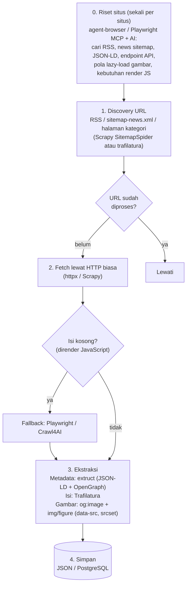

# Riset: Tools Scraping Berita (News Scraping)

> **Tujuan:** mengambil dari situs berita:
> 1. **URL berita** (daftar artikel)
> 2. **Metadata** (judul, penulis, tanggal terbit, kategori, tag, deskripsi)
> 3. **Isi berita penuh** (body artikel, bersih dari iklan/menu)
> 4. **URL gambar** (gambar utama + gambar di dalam artikel)
>
> *Catatan: disusun 1 November 2026 dari pengetahuan umum, bukan dari pengujian setiap tool. Detail fitur, harga, dan status proyek bisa berubah; verifikasi di dokumentasi resmi sebelum memilih.*
>
> **Status:** implementasi project ini memilih jalur berbeda dari rekomendasi §4: agent-browser dipakai untuk semua halaman artikel. Alasannya ada di [ADR-0001](../adr/0001-penggunaan-agent-browser-di-server.md).

---

## 1. Insight Penting: Situs Berita Itu "Ramah Scraping"

Sebelum memilih tool, pahami bahwa situs berita hampir selalu menyediakan data terstruktur (kebutuhan SEO dan agregator seperti Google News). Artinya **seringkali tidak perlu browser sama sekali.**

| Kebutuhan | Sumber data terbaik | Keterangan |
|---|---|---|
| **URL berita** | `sitemap.xml`, **News Sitemap** (`sitemap-news.xml`), **RSS/Atom feed**, halaman indeks/kategori | Cek `robots.txt` → biasanya mencantumkan sitemap |
| **Metadata** | **JSON-LD `NewsArticle`** (`<script type="application/ld+json">`), **OpenGraph** (`og:title`, `og:image`, `article:published_time`), `<meta name="author">` | JSON-LD paling lengkap: headline, author, datePublished, dateModified, image, articleSection |
| **Isi penuh** | Ekstraktor konten (algoritma "readability") | Membuang menu, iklan, "baca juga", komentar |
| **URL gambar** | `og:image` / JSON-LD `image` (gambar utama) + ``/`<figure>` di dalam body | Perhatikan lazy-load: `data-src`, `srcset`, `<picture>` |

**Kesimpulan awal:** untuk berita, urutan prioritas pendekatan adalah
`RSS/Sitemap → HTTP request + parser metadata + ekstraktor isi → (fallback) browser`.

---

## 2. Perbandingan Tools

### Kategori A — Ekstraktor Artikel (khusus berita/artikel) ⭐ paling relevan

#### Trafilatura (Python)
- **Keunggulan**
  - Salah satu ekstraktor isi artikel paling akurat di benchmark akademik
  - Ekstrak isi + metadata (judul, penulis, tanggal, kategori, tag) sekaligus
  - Bisa baca sitemap & RSS untuk discovery URL
  - Output: teks, Markdown, JSON, XML; bisa sertakan gambar
  - Cepat, ringan (tanpa browser), gratis, open source
- **Kelemahan**
  - Tidak merender JavaScript → gagal di situs yang isinya di-load via JS
  - Ekstraksi gambar inline kurang lengkap dibanding parsing manual
  - Tidak menangani login/paywall
- **Cocok untuk:** pipeline berita skala besar, situs berita "tradisional" (server-rendered). **Pilihan utama.**

#### newspaper4k (Python, penerus newspaper3k)
- **Keunggulan**
  - Didesain khusus untuk berita: `Article` → title, authors, publish_date, text, top_image, images, keywords
  - API sangat simpel; ada fitur `Source` untuk crawl satu situs berita
  - Langsung memberi `top_image` dan daftar `images` → pas dengan kebutuhan URL gambar
- **Kelemahan**
  - Akurasi ekstraksi isi umumnya di bawah Trafilatura
  - Deteksi tanggal/penulis kadang meleset di situs non-Inggris
  - Tanpa render JS
- **Cocok untuk:** prototipe cepat, kebutuhan "artikel + gambar" sederhana.

#### Mozilla Readability (JS) / readability-lxml (Python)
- **Keunggulan:** algoritma Reader View Firefox, teruji di jutaan halaman, bisa dipakai bersama Playwright/browser
- **Kelemahan:** hanya isi + judul/byline; metadata lain & gambar harus diparsing sendiri
- **Cocok untuk:** komponen ekstraksi isi di pipeline Node.js.

#### extruct (Python) / metascraper (Node)
- **Keunggulan:** ekstrak JSON-LD, OpenGraph, microdata secara lengkap dan rapi
- **Kelemahan:** hanya metadata, bukan isi
- **Cocok untuk:** lapisan metadata yang andal, dipasangkan dengan Trafilatura/Readability.

---

### Kategori B — Crawler / Scraper Klasik (tanpa AI)

#### Scrapy (Python)
- **Keunggulan**
  - Framework crawling paling matang: antrian, concurrency, retry, throttling, dedup, pipeline penyimpanan
  - Sangat cepat untuk ribuan–jutaan halaman
  - Ada `SitemapSpider` — pas untuk news sitemap
- **Kelemahan**
  - Kurva belajar lebih tinggi
  - Tanpa render JS (perlu plugin `scrapy-playwright`)
  - Selector per situs harus ditulis manual (kecuali dipadukan dengan Trafilatura)
- **Cocok untuk:** produksi, banyak situs berita, jadwal rutin. **Pilihan utama untuk skala besar** (Scrapy + Trafilatura).

#### httpx/requests + BeautifulSoup / selectolax
- **Keunggulan:** paling sederhana dan ringan, kontrol penuh
- **Kelemahan:** semua logika (crawling, retry, ekstraksi) ditulis sendiri
- **Cocok untuk:** 1–3 situs, skrip kecil.

#### Playwright / Puppeteer
- **Keunggulan:** render JS penuh, bisa klik "load more", scroll, login; tangkap respons API
- **Kelemahan:** berat (CPU/RAM), lambat dibanding HTTP biasa, lebih mudah terdeteksi bot
- **Cocok untuk:** situs berita SPA, infinite scroll, atau sebagai fallback.

---

### Kategori C — Konversi Web → Data siap-AI

#### Firecrawl
- **Keunggulan**
  - `crawl`/`map` seluruh situs + `scrape` → Markdown/HTML bersih + metadata
  - Render JS, mode ekstraksi terstruktur dengan schema (pakai LLM)
  - API managed (tinggal pakai) atau self-host
- **Kelemahan**
  - Versi cloud berbayar per halaman/kredit; mahal di skala besar
  - Markdown kadang masih membawa elemen non-artikel
  - Self-host butuh setup infrastruktur
- **Cocok untuk:** cepat jalan tanpa banyak coding, kebutuhan RAG/knowledge base, volume menengah.

#### Crawl4AI (Python, open source)
- **Keunggulan**
  - Gratis, berbasis Playwright (render JS), output Markdown untuk LLM
  - Strategi ekstraksi: CSS/XPath schema (tanpa LLM) atau berbasis LLM
  - Mengembalikan daftar media (gambar) & link per halaman
- **Kelemahan**
  - Selalu pakai browser → lebih berat dari Trafilatura
  - API berubah cukup sering
- **Cocok untuk:** situs berita yang butuh render JS, sambil tetap open source.

#### Jina Reader (`r.jina.ai/<url>`)
- **Keunggulan:** paling simpel — satu request → Markdown artikel + judul
- **Kelemahan:** ketergantungan layanan eksternal, rate limit, metadata terbatas, tanpa kontrol crawling
- **Cocok untuk:** uji cepat / volume kecil.

---

### Kategori D — Browser untuk AI Agent

#### agent-browser (Vercel Labs)
- **Keunggulan**
  - CLI Rust + daemon → perintah cepat, browser tetap hidup antar perintah
  - Snapshot accessibility tree + ref (`@e1`) → hemat token, AI mudah memahami halaman
  - Fitur `read` (teks halaman ramah agent), network/HAR untuk menangkap API internal situs
  - Sesi login tersimpan, auth vault, policy keamanan
- **Kelemahan**
  - Dirancang untuk **agent interaktif**, bukan crawler massal: tidak ada antrian/dedup/scheduler
  - Pakai browser penuh → lambat & berat untuk ribuan artikel
  - Tiap langkah melibatkan LLM → mahal jika dipakai per artikel
- **Cocok untuk:** **eksplorasi & riset struktur situs** (temukan RSS, sitemap, endpoint API, selector), debugging situs yang sulit, scraping ad-hoc beberapa artikel.

#### Playwright MCP (Microsoft)
- **Keunggulan:** konsep mirip (snapshot + ref), integrasi MCP standar ke banyak klien AI
- **Kelemahan:** sama seperti agent-browser — bukan untuk volume besar
- **Cocok untuk:** sama seperti agent-browser, jika ekosistemmu berbasis MCP.

#### Stagehand (Browserbase)
- **Keunggulan:** `extract()` dengan schema (Zod) → langsung JSON terstruktur (judul, tanggal, isi, gambar); kombinasi kode biasa + AI
- **Kelemahan:** tiap `extract` memanggil LLM → biaya & latensi; paling optimal dengan Browserbase (berbayar)
- **Cocok untuk:** situs berita dengan struktur aneh/berubah-ubah, volume kecil–menengah.

#### Browser Use (Python)
- **Keunggulan:** agent otonom — beri tujuan dalam bahasa natural
- **Kelemahan:** paling lambat, paling mahal, hasil kurang deterministik
- **Cocok untuk:** tugas sekali jalan yang rumit; **tidak disarankan** untuk pipeline berita.

---

### Kategori E — Infrastruktur Browser Cloud
**Browserbase, Steel, Browserless, Hyperbrowser**
- **Keunggulan:** browser di cloud, proxy, rotasi IP, penanganan captcha, skalabilitas
- **Kelemahan:** berbayar; bukan ekstraktor — tetap butuh tool lain
- **Cocok untuk:** situs dengan proteksi bot / rate limit ketat (tetap patuhi ToS).

---

## 3. Matriks Ringkas untuk Kebutuhan Berita

Skala: ✅ baik · ⚠️ sebagian/perlu tambahan · ❌ tidak

| Tool | URL berita | Metadata | Isi penuh | URL gambar | Render JS | Skala besar | Biaya |
|---|---|---|---|---|---|---|---|
| **Trafilatura** | ✅ (sitemap/RSS) | ✅ | ✅ terbaik | ⚠️ | ❌ | ✅ | Gratis |
| **newspaper4k** | ✅ | ✅ | ✅ | ✅ | ❌ | ⚠️ | Gratis |
| **extruct / metascraper** | ❌ | ✅ terbaik | ❌ | ✅ (og:image) | ❌ | ✅ | Gratis |
| **Scrapy** | ✅ terbaik | ⚠️ manual | ⚠️ manual | ⚠️ manual | ⚠️ plugin | ✅ terbaik | Gratis |
| **Playwright** | ⚠️ manual | ⚠️ manual | ⚠️ manual | ✅ | ✅ | ⚠️ | Gratis |
| **Crawl4AI** | ✅ | ✅ | ✅ | ✅ | ✅ | ⚠️ | Gratis |
| **Firecrawl** | ✅ | ✅ | ✅ | ✅ | ✅ | ⚠️ (biaya) | Berbayar/self-host |
| **Jina Reader** | ❌ | ⚠️ | ✅ | ⚠️ | ✅ | ❌ | Freemium |
| **agent-browser** | ⚠️ | ⚠️ | ⚠️ | ✅ | ✅ | ❌ | Gratis + biaya LLM |
| **Stagehand** | ⚠️ | ✅ | ✅ | ✅ | ✅ | ❌ | Biaya LLM (+Browserbase) |
| **Browser Use** | ⚠️ | ⚠️ | ⚠️ | ⚠️ | ✅ | ❌ | Biaya LLM tinggi |

---

## 4. Rekomendasi Arsitektur

### Rekomendasi utama: Hybrid bertingkat



**Stack yang disarankan:**

| Skenario | Stack |
|---|---|
| Mulai cepat, 1–5 situs | `newspaper4k` atau `trafilatura` + `extruct` |
| Produksi, banyak situs, rutin | **Scrapy + Trafilatura + extruct** (+ `scrapy-playwright` untuk situs JS) |
| Situs berita berat JS | **Crawl4AI** (gratis) atau **Firecrawl** (managed) |
| Tidak mau coding banyak, budget ada | **Firecrawl** |
| Situs aneh / sering berubah, volume kecil | **Stagehand** `extract()` dengan schema |
| Riset & debugging struktur situs | **agent-browser** |

### Posisi agent-browser dalam proyek ini
agent-browser **bukan** mesin scraping utama untuk berita, tapi sangat berguna sebagai **"alat riset"**:
- membuka situs dan meminta AI menemukan feed/sitemap/JSON-LD,
- merekam HAR untuk menemukan API internal (sering mengembalikan JSON artikel lengkap),
- memverifikasi apakah isi muncul tanpa JS,
- menguji selector gambar lazy-load.

Setelah polanya diketahui, implementasikan di pipeline ringan (Trafilatura/Scrapy) agar cepat dan murah.

---

## 5. Contoh Skema Output

```json
{
  "url": "https://contoh-berita.com/2026/11/01/judul-berita",
  "source": "contoh-berita.com",
  "title": "Judul Berita",
  "description": "Ringkasan dari meta description / og:description",
  "authors": ["Nama Penulis"],
  "published_at": "2026-11-01T08:30:00+07:00",
  "updated_at": "2026-11-01T10:00:00+07:00",
  "section": "Ekonomi",
  "tags": ["inflasi", "BI"],
  "language": "id",
  "content_text": "Isi berita penuh ...",
  "content_html": "<p>Isi berita penuh ...</p>",
  "main_image": "https://contoh-berita.com/img/utama.jpg",
  "images": [
    { "url": "https://contoh-berita.com/img/1.jpg", "caption": "Keterangan foto" }
  ],
  "scraped_at": "2026-11-01T12:00:00Z"
}
```

---

## 6. Tantangan Umum di Situs Berita

| Masalah | Solusi |
|---|---|
| Artikel multi-halaman (`?page=2`, "Halaman selanjutnya") | Deteksi link pagination, gabungkan isi; beberapa situs punya `?page=all` / versi AMP |
| Gambar lazy-load | Baca `data-src`, `data-original`, `srcset` (ambil resolusi terbesar), `<noscript>` |
| Blok "Baca juga" / iklan di tengah isi | Trafilatura umumnya sudah membuang; tambah filter selector per situs jika perlu |
| Isi di-load via JS | Cek dulu API internal (via HAR); jika tidak ada → Playwright/Crawl4AI |
| Paywall | Hormati; jangan bypass. Ambil metadata/ringkasan yang tersedia publik saja |
| Rate limit / blokir | Throttle (1–2 req/detik per domain), User-Agent jelas, cache, hormati `Crawl-delay` |
| Tanggal format lokal ("1 November 2026 08:30 WIB") | Prioritaskan JSON-LD `datePublished` (ISO 8601); fallback ke `dateparser` |
| Duplikat (URL dengan parameter tracking) | Normalisasi URL, pakai `<link rel="canonical">` |

---

## 7. Etika & Legal

- Cek dan patuhi **`robots.txt`** serta **Terms of Service** situs.
- Isi berita dilindungi **hak cipta**: aman untuk riset/analisis internal; **jangan republish** isi penuh tanpa izin.
- Jangan membebani server (rate limit), jangan bypass paywall atau proteksi akses.
- Simpan atribusi (sumber, URL, penulis).

---

## 8. Langkah Selanjutnya

1. Tentukan daftar situs berita target.
2. Untuk tiap situs: cek `robots.txt`, RSS, sitemap-news, dan JSON-LD (bisa dibantu agent-browser).
3. Prototipe dengan `trafilatura` + `extruct` pada 20–50 artikel; ukur akurasi isi & gambar.
4. Jika berhasil → bungkus dengan Scrapy untuk penjadwalan & skala.
5. Situs yang gagal (JS-heavy) → fallback Crawl4AI/Playwright.
