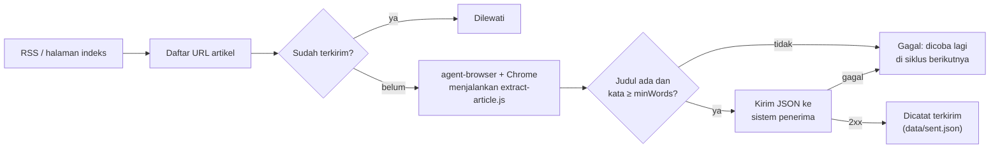
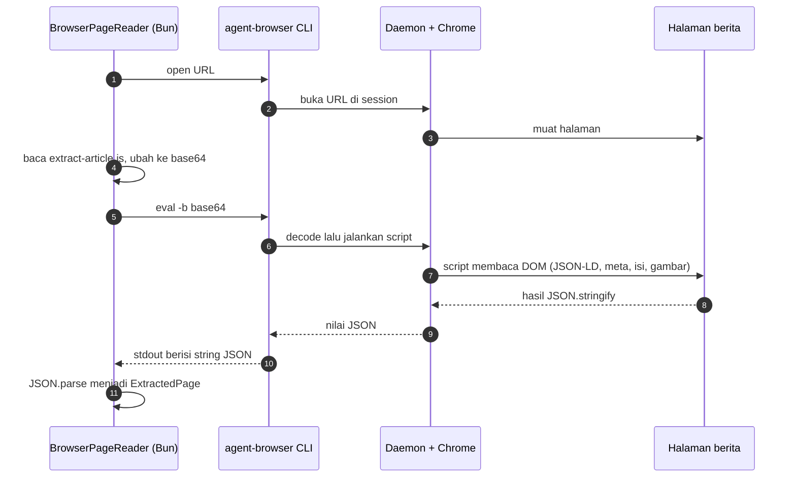
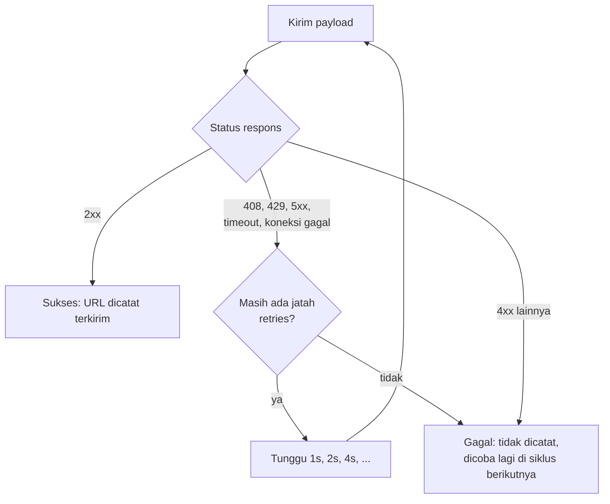
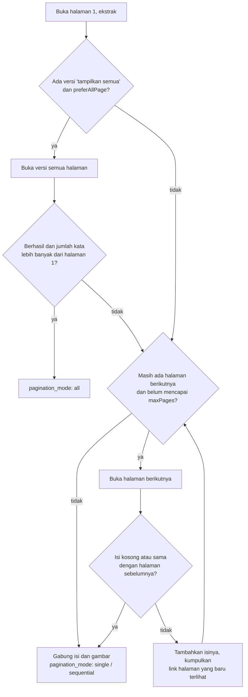
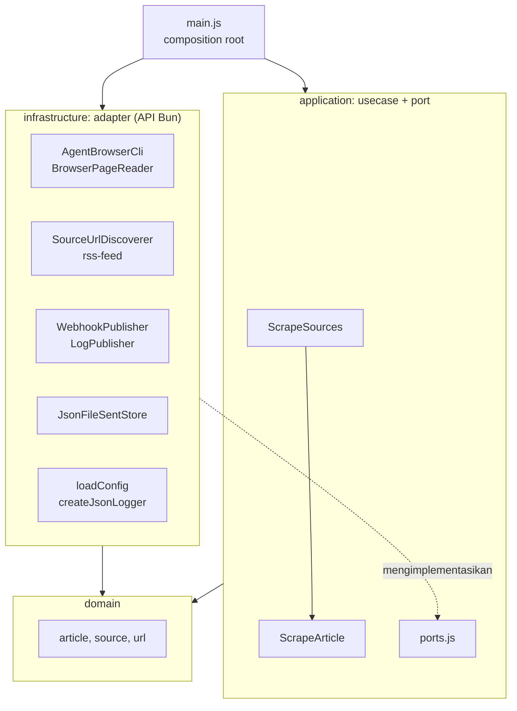

# News Scraper (agent-browser → webhook)

Mengambil berita (URL, metadata, isi penuh, URL gambar) lewat **agent-browser**, lalu mengirim setiap artikel ke sistem luar melalui **HTTP POST/PATCH/PUT**. Sistem penerima bebas (Go, PHP, n8n, dan lainnya); syaratnya hanya bisa menerima JSON lewat HTTP.



## Cara Kerja

`extract-article.js` **bukan bagian dari agent-browser**. Itu skrip JavaScript milik project ini yang dijalankan di dalam halaman berita lewat perintah `eval` agent-browser.

Analoginya seperti membuka DevTools (F12) → tab Console di Chrome lalu mengetik kode JS:

| Manual di Chrome | Lewat agent-browser |
|---|---|
| Buka Chrome, ketik URL | `agent-browser open <url>` |
| F12, buka Console, tempel kode JS | `agent-browser eval "<kode JS>"` |
| Lihat hasil di Console | Hasil dicetak ke terminal (stdout) |

### Alur satu halaman



Script dikirim dalam base64 (`eval -b`) karena di PowerShell `eval --stdin` selalu mengembalikan `null` dan kode JS panjang rawan masalah escaping.

### Apa yang dibaca `extract-article.js`

Situs berita menyertakan data terstruktur di HTML untuk mesin pencari. Skrip ini memungutnya dengan urutan prioritas:

1. **JSON-LD** (`<script type="application/ld+json">` dengan `@type` `NewsArticle`/`Article`): judul, deskripsi, penulis, tanggal, seksi, kata kunci, gambar.
   ```html
   <script type="application/ld+json">
   { "@type": "NewsArticle", "headline": "Mensos mengajak RT...",
     "datePublished": "2026-11-01T22:39:01+07:00",
     "author": { "name": "Sumarwoto" }, "image": "https://cdn...jpg" }
   </script>
   ```
2. **Meta tag OpenGraph** sebagai cadangan jika JSON-LD tidak ada:
   ```html
   <meta property="og:title" content="Mensos mengajak RT...">
   <meta property="og:image" content="https://cdn...jpg">
   ```
3. **Isi artikel:** kotak isi pertama yang teksnya lebih dari 200 karakter, dari daftar selector (`[itemprop="articleBody"]`, `.post-content`, `.read__content`, ..., `article`). Iklan, `aside`, blok "baca juga", dan blok terkait dibuang, lalu semua `<p>` diambil.
4. **Gambar:** semua `` di dalam artikel, termasuk lazy-load (`srcset` resolusi terbesar, `data-src`, `data-original`). Gambar utama (`og:image` / JSON-LD) selalu di urutan pertama.
5. **Tag:** dari JSON-LD/meta `keywords`; jika kosong, dari teks link `/tag/`.
6. **Pagination:** link ke path artikel yang sama (lihat [Artikel multi-halaman](#artikel-multi-halaman)).

### Coba manual

```bash
agent-browser open https://www.antaranews.com/terkini
agent-browser eval "document.title"
agent-browser eval "document.querySelectorAll('a').length"
agent-browser eval "document.querySelector('meta[property=og:image]').content"
agent-browser close
```

Setiap `eval` di atas adalah potongan kecil dari apa yang dilakukan `extract-article.js` sekaligus.

### Pembagian tugas

| Komponen | Tugas |
|---|---|
| **agent-browser** | Membuka halaman di Chrome dan menjalankan JavaScript di dalamnya |
| **extract-article.js** | Memungut data artikel dari DOM halaman |
| **Usecase** (`src/application`) | Mengatur urutan: discover → buka → ekstrak → validasi → kirim → catat |

agent-browser **tidak memakai AI atau token AI**; ia alat otomasi browser. Kata "agent" pada namanya berarti alat ini mudah dipakai oleh AI agent. Seluruh scraper ini berjalan tanpa API key AI.

## Kebutuhan

| Komponen | Versi teruji | Keterangan |
|---|---|---|
| [Bun](https://bun.sh) | 1.4.4 | Runtime scraper; tanpa dependency, tidak perlu `bun install` |
| agent-browser | 0.41.1 | Dipasang lewat npm, jadi Node.js/npm juga dibutuhkan |
| Chrome for Testing | 156 | Diunduh oleh `agent-browser install` |

```bash
npm install -g agent-browser@0.41.1
agent-browser install            # Linux: agent-browser install --with-deps (belum diuji)
```

## Menjalankan

Semua perintah dijalankan dari folder `scraper/`.

```bash
bun run dry-run     # 1 siklus: tampilkan payload, tidak mengirim, tidak menulis state
bun run once        # 1 siklus lalu keluar (cocok untuk cron)
bun start           # jalan terus, 1 siklus tiap intervalMinutes
bun test            # unit test bun:test (tanpa browser dan jaringan)
```

Setara dengan `bun src/main.js [--once] [--dry-run] [--config <path>]`. Argumen lain ditolak dengan pesan `unknown argument`.

Uji lokal dengan penerima tiruan:

```bash
bun run mock        # terminal 1: penerima (Bun.serve) di http://localhost:8080
bun run once        # terminal 2: payload tersimpan di data/received.jsonl
```

`--dry-run` tetap membaca `data/sent.json`, jadi artikel yang sudah terkirim ikut dilewati.

### Runtime: Bun

Seluruh kode memakai API Bun, tanpa import `node:*` maupun dependency npm:

| Kebutuhan | API Bun |
|---|---|
| Menjalankan agent-browser | `Bun.spawn`, `Bun.which` |
| Baca/tulis file (folder induk dibuat otomatis) | `Bun.file`, `Bun.write` |
| Penulisan state yang aman (tulis file sementara lalu pindahkan) | Bun Shell `` $`mv ...` `` |
| Hash ID artikel | `Bun.CryptoHasher` |
| Path dan URL file | `import.meta.url`, `Bun.fileURLToPath`, `Bun.pathToFileURL` |
| Argumen dan env | `Bun.argv`, `Bun.env` |
| Jeda | `Bun.sleep` |
| Penerima tiruan | `Bun.serve` |
| Test | `bun:test` |

Pengecualian: `src/infrastructure/browser/scripts/extract-article.js` berjalan di dalam Chrome, jadi memakai API DOM browser.

## Konfigurasi (`config.json`)

| Field | Default | Keterangan |
|---|---|---|
| `webhook.url` | (wajib) | Endpoint penerima. `{id}` diganti dengan ID artikel, mis. `https://api.example.com/articles/{id}` |
| `webhook.method` | `POST` | `POST`, `PATCH`, atau `PUT` |
| `webhook.headers` | `{}` | Header tambahan |
| `webhook.timeoutMs` | `15000` | Timeout per request |
| `webhook.retries` | `3` | Jumlah percobaan ulang setelah percobaan pertama |
| `userAgent` | `NewsScraperBot/1.0` | User-Agent untuk request RSS. Halaman artikel dibuka dengan User-Agent bawaan Chrome |
| `session` | `newscraper` | Nama session agent-browser |
| `intervalMinutes` | `30` | Jeda antar siklus pada mode jalan terus |
| `delayMs` | `1500` | Jeda antar artikel |
| `statePath` | `data/sent.json` | File pencatat URL terkirim; path relatif dihitung dari folder `config.json` |
| `sources[].name` | (wajib) | Nama sumber, dikirim sebagai `source` di payload |
| `sources[].discovery` | (wajib) | `{ "type": "rss", "url": ... }` (diambil lewat HTTP) atau `{ "type": "index", "url": ... }` (dibuka lewat browser) |
| `sources[].pattern` | - | Regex URL artikel. Awali dengan `^https://` agar link iklan yang memuat URL artikel di query tidak ikut |
| `sources[].waitFor` | - | Selector yang ditunggu setelah halaman dibuka; untuk situs yang isinya dirender JavaScript |
| `sources[].minWords` | `50` | Artikel dengan isi lebih pendek dianggap tidak lengkap |
| `sources[].maxArticles` | tanpa batas | Batas artikel **baru** per siklus |
| `sources[].preferAllPage` | `true` | Artikel multi-halaman: pakai versi "tampilkan semua" jika ada |
| `sources[].maxPages` | `10` | Batas halaman yang diikuti untuk satu artikel |

### Variabel lingkungan

Rahasia disimpan di `.env`, bukan di `config.json`. Bun membaca `.env` di folder kerja secara otomatis, dan `.env` sudah masuk `.gitignore`.

```bash
cp .env.example .env
```

| Env | Fungsi |
|---|---|
| `WEBHOOK_URL` | Menimpa `webhook.url` |
| `WEBHOOK_METHOD` | Menimpa `webhook.method` |
| `WEBHOOK_TOKEN` | Dikirim sebagai `Authorization: Bearer <token>` |
| `AGENT_BROWSER_BIN` | Path binary agent-browser; jika kosong, dicari otomatis di PATH |

Variabel yang kosong (mis. `WEBHOOK_TOKEN=`) dianggap tidak diisi. Di Windows, tulis path dengan `/` karena di dalam tanda kutip ganda Bun membaca `\n` sebagai baris baru.

## Kontrak untuk sistem penerima

### Request

```http
POST /articles HTTP/1.1
Content-Type: application/json
Idempotency-Key: f93e573f77d31000aef85ad479252985
Authorization: Bearer <WEBHOOK_TOKEN>
```

`Authorization` hanya dikirim jika `WEBHOOK_TOKEN` diisi. Header dari `webhook.headers` ikut dikirim.

```json
{
  "id": "f93e573f77d31000aef85ad479252985",
  "source": "antaranews",
  "scraped_at": "2026-11-01T16:05:13.244Z",
  "article": {
    "url": "https://www.antaranews.com/berita/5825335/...",
    "title": "Anggota DPR usul pembentukan TGPF ...",
    "description": "Anggota Komisi III DPR RI ...",
    "authors": ["Bagus Ahmad Rizaldi"],
    "published_at": "2026-11-01T22:59:19+07:00",
    "updated_at": "2026-11-01T22:59:19+07:00",
    "section": "Indonesia",
    "tags": ["PENGGELEDAHAN PONPES", "POLDA JAWA TENGAH"],
    "main_image": "https://cdn.antaranews.com/cache/1200x800/2026/11/01/1000094283.jpg",
    "images": [{ "url": "https://cdn.antaranews.com/...jpg", "caption": null }],
    "content_text": "Jakarta (ANTARA) - ...",
    "word_count": 390,
    "page_count": 1,
    "pagination_mode": "single"
  }
}
```

| Field | Arti |
|---|---|
| `id` | 32 karakter pertama SHA-256 dari `article.url`. Stabil antar-retry dan antar-siklus, sehingga penerima bisa melakukan upsert atau menolak duplikat. Sama dengan header `Idempotency-Key` |
| `source` | `sources[].name` dari config |
| `scraped_at` | Waktu ekstraksi, ISO 8601 UTC |
| `article.url` | URL artikel hasil discovery setelah normalisasi (parameter `utm_*`, `fbclid`, `gclid`, dan fragment dibuang) |
| `title`, `description` | Dari JSON-LD, lalu OpenGraph/meta |
| `authors` | Array nama; bisa berisi nama penerbit jika situs tidak mencantumkan wartawan |
| `published_at`, `updated_at` | String apa adanya dari situs (tidak dinormalisasi zona waktunya); `null` jika tidak ada |
| `section`, `tags` | Seksi/kanal dan tag; `null` atau `[]` jika tidak ada |
| `main_image` | URL gambar utama |
| `images` | `{ url, caption }`; gambar utama di urutan pertama |
| `content_text` | Teks polos isi artikel, paragraf dipisah baris kosong (`\n\n`); untuk artikel multi-halaman berisi gabungan semua halaman |
| `word_count` | Jumlah kata `content_text` |
| `page_count` | Jumlah halaman artikel di situs sumber |
| `pagination_mode` | `single`, `all` (dari versi "tampilkan semua"), atau `sequential` (halaman diikuti lalu digabung) |

### Respons yang diharapkan



| Status dari penerima | Perilaku scraper |
|---|---|
| `2xx` | Sukses; URL dicatat di `statePath` dan tidak dikirim lagi |
| `408`, `429`, `5xx`, timeout, koneksi gagal | Diulang sampai `retries` kali dengan jeda 1s, 2s, 4s, ...; jika tetap gagal, dicoba lagi di siklus berikutnya |
| `4xx` lainnya | Tidak diulang di siklus ini (kesalahan data/konfigurasi); dicoba lagi di siklus berikutnya |

URL dicatat terkirim hanya setelah respons `2xx` (`src/application/scrape-sources.js`), jadi kegagalan apa pun tidak pernah membuat artikel hilang dari antrean.

## Artikel multi-halaman

Sebagian situs (mis. Kompas) memecah satu artikel menjadi beberapa halaman. agent-browser hanya membuka satu halaman, jadi penanganannya ada di project ini:

1. `extract-article.js` mencari link pagination milik artikel itu sendiri (path yang sama): `?page=N`, `?p=N`, `/N`, `?page=all`, `/all`, atau teks "Show All" / "Tampilkan Semua". Pagination halaman indeks atau galeri diabaikan karena path-nya berbeda.
2. Usecase `ScrapeArticle` (`src/application/scrape-article.js`) memilih strategi:



Isi yang kosong atau sama berarti situs mengabaikan parameter halaman, sehingga penelusuran berhenti.

Hasil uji pada artikel Kompas 2 halaman (Windows lokal, 1 November 2026):

| Cara | Kata | Waktu |
|---|---|---|
| Hanya halaman 1, tanpa penanganan pagination | 287 (54%) | - |
| Versi "tampilkan semua" | 530 | 6,6 dtk |
| Mengikuti halaman 2 (`preferAllPage: false`) | 530 | 15,5 dtk |
| Artikel antaranews 1 halaman (pembanding) | 492, sama dengan ekstraksi tanpa pagination | 1,6 dtk |

## Arsitektur



**Aturan dependensi:** panah hanya mengarah ke dalam. `domain` tidak meng-import apa pun dari project ini. `application` hanya mengenal `domain` dan port. Detail teknis (agent-browser, HTTP, file) hanya ada di `infrastructure`. `main.js` satu-satunya tempat merakit semuanya.

- **Mudah diganti:** pindah dari agent-browser ke Playwright cukup membuat `PageReader` baru; pindah dari webhook ke database atau antrean cukup membuat `ArticlePublisher` baru. Usecase tidak berubah.
- **Mudah diuji:** usecase diuji dengan implementasi palsu (`test/application/fakes.js`), tanpa browser dan jaringan.

### Struktur folder

```
scraper/
├─ config.json
├─ .env.example                               contoh variabel lingkungan (salin ke .env)
├─ package.json
├─ src/
│  ├─ main.js                                 composition root + CLI
│  ├─ domain/
│  │  ├─ article.js                           ID artikel, validasi, penggabungan halaman
│  │  ├─ source.js                            definisi sumber + nilai default
│  │  └─ url.js                               normalisasi URL
│  ├─ application/
│  │  ├─ ports.js                             kontrak: PageReader, UrlDiscoverer, ArticlePublisher, SentStore, Logger
│  │  ├─ scrape-article.js                    usecase: 1 artikel lengkap (multi-halaman)
│  │  └─ scrape-sources.js                    usecase: 1 siklus semua sumber
│  └─ infrastructure/
│     ├─ browser/
│     │  ├─ agent-browser-cli.js              pembungkus CLI agent-browser
│     │  ├─ browser-page-reader.js            PageReader: open + eval ekstraktor
│     │  └─ scripts/extract-article.js        berjalan di dalam halaman: JSON-LD → OpenGraph → DOM
│     ├─ discovery/
│     │  ├─ rss-feed.js                       link dari RSS/Atom
│     │  └─ source-url-discoverer.js          UrlDiscoverer: RSS atau halaman indeks
│     ├─ publishing/
│     │  ├─ payload.js                        format JSON untuk penerima
│     │  ├─ webhook-publisher.js              ArticlePublisher: HTTP + retry
│     │  └─ log-publisher.js                  ArticlePublisher untuk --dry-run
│     ├─ persistence/json-file-sent-store.js  SentStore: catatan URL terkirim
│     ├─ config/load-config.js                config.json + env
│     └─ logging/json-logger.js               Logger: JSON per baris
├─ tools/mock-receiver.js                     penerima tiruan untuk uji coba
└─ test/
   ├─ domain/article.test.js
   ├─ application/                            usecase diuji dengan fakes.js
   └─ infrastructure/load-config.test.js
```

### Menambah kemampuan baru

| Kebutuhan | Yang dibuat | Yang diubah |
|---|---|---|
| Kirim ke database atau antrean | `infrastructure/publishing/<nama>-publisher.js` dengan method `publish(record)` | Satu baris di `main.js` |
| Ganti agent-browser dengan Playwright | `infrastructure/browser/<nama>-page-reader.js` dengan method `read(url, { waitFor })` | Satu baris di `main.js` |
| Simpan state di Redis | `infrastructure/persistence/redis-sent-store.js` dengan `has` / `markSent` | Satu baris di `main.js` |
| Jenis discovery baru (mis. sitemap) | Tambah ke `DISCOVERY_TYPES` dan `SourceUrlDiscoverer` | `domain/source.js`, discoverer |
| Situs berita baru | Entri di `config.json` | Ikuti skill `add-news-source` |

## Log

Satu baris JSON per kejadian di stdout (`fatal` di stderr):

| `msg` | Field penting |
|---|---|
| `starting` | `webhook`, `dryRun` |
| `discovered` | `source`, `found`, `pending` |
| `published` | `source`, `url`, `id`, `status` |
| `dry-run` | payload dengan `content_text` dipotong 120 karakter |
| `article failed` | `source`, `url`, `error` |
| `source done` | `source`, `published`, `failed` |
| `source failed` | `source`, `error` (mis. RSS tidak bisa diambil) |
| `sleeping`, `shutting down`, `stopped` | siklus dan penghentian |

## Catatan

- **Kinerja terukur:** 2,0–2,8 detik per artikel termasuk `delayMs` 1,5 detik (dry-run 4 artikel antaranews, Bun 1.4.4, Windows lokal, 1 November 2026). Artikel diproses berurutan dalam satu session browser.
- Jangan memakai `wait --load networkidle`: iklan membuat halaman berita jarang "idle", dan daemon agent-browser tetap menunggu sekitar 25 detik walaupun proses CLI sudah dihentikan. Gunakan `waitFor`.
- Pada kompas.com, `agent-browser open` kadang mengembalikan error walaupun halaman sudah terbuka; adapter mengecek ulang dengan `get url`.
- tribunnews.com memblokir browser otomatis ("Akses ditolak").
- **Masalah kualitas data yang diketahui:** sisa label "Baca juga:", paragraf promosi (Kompas), gambar tidak terkait dari blok rekomendasi, `authors` berisi nama penerbit (Kompas), `section` kosong.
- Scraper **tidak memeriksa `robots.txt` secara otomatis**. Periksa `robots.txt` dan ToS setiap situs saat menambah sumber, dan jangan memublikasikan ulang isi berita tanpa izin. Footer artikel antaranews melarang pengindeksan otomatis untuk AI tanpa izin tertulis.
- `data/sent.json` bertambah terus tanpa pembersihan.
