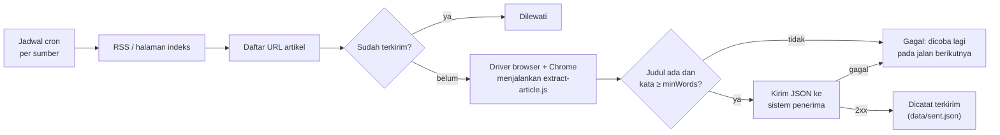
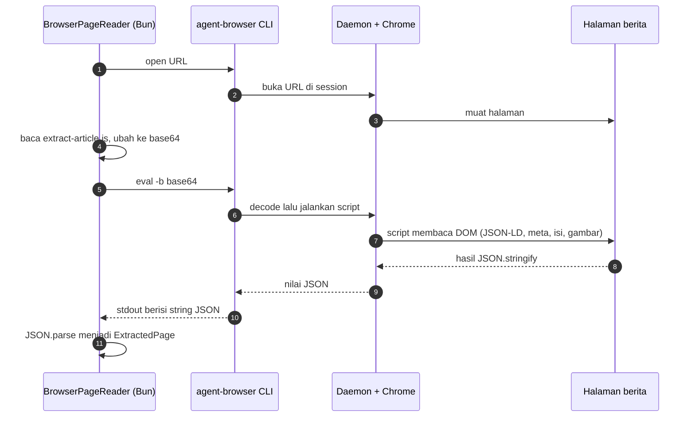
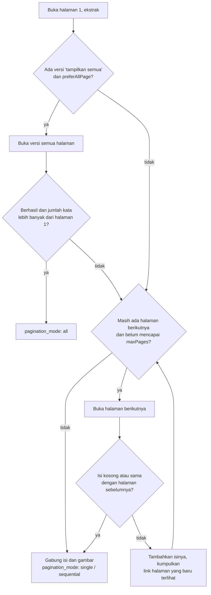
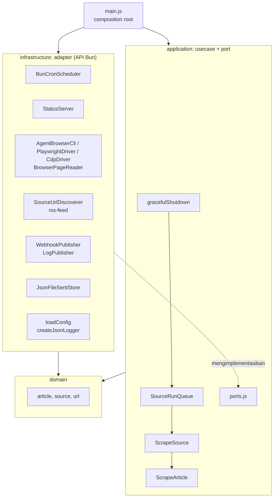

# News Scraper (agent-browser → webhook)

Mengambil berita (URL, metadata, isi penuh, URL gambar) lewat Chrome yang dikendalikan **agent-browser** (default), **Playwright**, atau **CDP langsung** (lihat [Driver browser](#driver-browser)), lalu mengirim setiap artikel ke sistem luar melalui **HTTP POST/PATCH/PUT**. Sistem penerima bebas (Go, PHP, n8n, dan lainnya); syaratnya hanya bisa menerima JSON lewat HTTP.

Scraper berjalan sebagai **server** yang hidup terus: setiap sumber dijalankan sesuai jadwal cron-nya sendiri, dan kondisinya bisa dilihat lewat `GET /health` dan `GET /status`.



## Cara Kerja

`extract-article.js` **bukan bagian dari agent-browser**. Itu skrip JavaScript milik project ini yang dijalankan di dalam halaman berita lewat perintah `eval` agent-browser.

Analoginya seperti membuka DevTools (F12) → tab Console di Chrome lalu mengetik kode JS:

| Manual di Chrome | Lewat agent-browser |
|---|---|
| Buka Chrome, ketik URL | `agent-browser open <url>` |
| F12, buka Console, tempel kode JS | `agent-browser eval "<kode JS>"` |
| Lihat hasil di Console | Hasil dicetak ke terminal (stdout) |

### Alur satu halaman



Script dikirim dalam base64 (`eval -b`) karena di PowerShell `eval --stdin` selalu mengembalikan `null` dan kode JS panjang rawan masalah escaping.

### Apa yang dibaca `extract-article.js`

Situs berita menyertakan data terstruktur di HTML untuk mesin pencari. Skrip ini memungutnya dengan urutan prioritas:

1. **JSON-LD** (`<script type="application/ld+json">` dengan `@type` `NewsArticle`/`Article`): judul, deskripsi, penulis, tanggal, seksi, kata kunci, gambar.
   ```html
   <script type="application/ld+json">
   { "@type": "NewsArticle", "headline": "Mensos mengajak RT...",
     "datePublished": "2026-11-01T22:39:01+07:00",
     "author": { "name": "Sumarwoto" }, "image": "https://cdn...jpg" }
   </script>
   ```
2. **Meta tag OpenGraph** sebagai cadangan jika JSON-LD tidak ada:
   ```html
   <meta property="og:title" content="Mensos mengajak RT...">
   <meta property="og:image" content="https://cdn...jpg">
   ```
3. **Isi artikel:** kotak isi pertama yang teksnya lebih dari 200 karakter, dari daftar selector (`[itemprop="articleBody"]`, `.post-content`, `.read__content`, ..., `article`). Iklan, `aside`, blok "baca juga", dan blok terkait dibuang, lalu semua `<p>` diambil.
4. **Gambar:** semua `` di dalam artikel, termasuk lazy-load (`srcset` resolusi terbesar, `data-src`, `data-original`). Gambar utama (`og:image` / JSON-LD) selalu di urutan pertama.
5. **Tag:** dari JSON-LD/meta `keywords`; jika kosong, dari teks link `/tag/`.
6. **Pagination:** link ke path artikel yang sama (lihat [Artikel multi-halaman](#artikel-multi-halaman)).

### Coba manual

```bash
agent-browser open https://www.antaranews.com/terkini
agent-browser eval "document.title"
agent-browser eval "document.querySelectorAll('a').length"
agent-browser eval "document.querySelector('meta[property=og:image]').content"
agent-browser close
```

Setiap `eval` di atas adalah potongan kecil dari apa yang dilakukan `extract-article.js` sekaligus.

### Pembagian tugas

| Komponen | Tugas |
|---|---|
| **agent-browser** | Membuka halaman di Chrome dan menjalankan JavaScript di dalamnya |
| **extract-article.js** | Memungut data artikel dari DOM halaman |
| **Usecase** (`src/application`) | Mengatur urutan: discover → buka → ekstrak → validasi → kirim → catat |

agent-browser **tidak memakai AI atau token AI**; ia alat otomasi browser. Kata "agent" pada namanya berarti alat ini mudah dipakai oleh AI agent. Seluruh scraper ini berjalan tanpa API key AI.

## Kebutuhan

| Komponen | Versi teruji | Keterangan |
|---|---|---|
| [Bun](https://bun.sh) | 1.4.4 | Runtime scraper (`engines.bun >= 1.4.4` karena `Bun.cron`) |
| agent-browser | 0.41.1 | Hanya untuk driver `agent-browser` (default). Dipasang lewat npm, jadi Node.js/npm juga dibutuhkan |
| `playwright-core` | 1.64.1 | Hanya untuk driver `playwright`. Satu-satunya dependency di `package.json`; dipasang dengan `bun install` |
| Chrome for Testing | 156 | Diunduh oleh `agent-browser install`. Driver `playwright` dan `cdp` bisa memakai Chrome yang sama lewat `CHROME_PATH` |

```bash
# Driver agent-browser (default)
npm install -g agent-browser@0.41.1
agent-browser install            # Linux: agent-browser install --with-deps (belum diuji)

# Driver playwright: pasang dependency
bun install
```

Driver `cdp` tidak butuh paket apa pun, hanya biner Chrome.

## Menjalankan

Semua perintah dijalankan dari folder `scraper/`.

```bash
bun start           # mode server: jadwalkan setiap sumber, buka /health dan /status
bun run once        # semua sumber sekali jalan lalu keluar
bun run dry-run     # sekali jalan: tampilkan payload, tidak mengirim, tidak menulis state
bun test            # unit test bun:test (tanpa browser dan jaringan)
bun run bench       # benchmark driver browser (lihat "Benchmark driver browser")
bun run bench:accuracy  # akurasi ekstraksi terhadap halaman asli
```

Setara dengan `bun src/main.js [--once] [--dry-run] [--source <nama>] [--config <path>]`:

| Argumen | Fungsi |
|---|---|
| (tanpa `--once`) | Mode server, berjalan sampai dihentikan |
| `--once` | Jalankan sumber sekali secara berurutan, lalu keluar |
| `--source <nama>` | Batasi ke satu sumber (di kedua mode); nama yang tidak ada ditolak dengan daftar nama yang tersedia |
| `--dry-run` | Tampilkan payload tanpa mengirim dan tanpa menulis `statePath` (di kedua mode) |
| `--config <path>` | File config lain (default `config.json`) |

Argumen lain ditolak dengan pesan `unknown argument`. Pemicu manual sebuah sumber memakai `bun src/main.js --once --source <nama>`; server tidak menyediakan endpoint pemicu.

Uji lokal dengan penerima tiruan:

```bash
bun run mock        # terminal 1: penerima (Bun.serve) di http://localhost:8080
bun run once        # terminal 2: payload tersimpan di data/received.jsonl
```

`--dry-run` tetap membaca `data/sent.json`, jadi artikel yang sudah terkirim ikut dilewati.

### Benchmark driver browser

```bash
CHROME_PATH=<path chrome> bun run bench --sources detik,liputan6 --articles 3
```

`tools/compare-drivers.js` mengambil daftar URL dari RSS satu kali, lalu membuka setiap URL dengan semua driver secara bergiliran. Hasilnya berupa tabel ringkasan (berhasil, mulai dingin, median, p95, puncak memori Chrome) dan kesetaraan isi antar driver. Tidak ada payload yang dikirim, `statePath` tidak dibaca maupun ditulis, dan jadwal cron tidak dipakai.

| Argumen | Default | Fungsi |
|---|---|---|
| `--sources a,b` | semua sumber | Sumber yang diuji; hanya discovery `rss` yang didukung |
| `--articles N` | `3` | Artikel terbaru per sumber |
| `--drivers a,b` | `agent-browser,cdp,playwright` | Driver yang dibandingkan; yang pertama menjadi pembanding kesetaraan isi. `go` dan `go-trafilatura` (opsional) menjalankan [`go-scraper`](../go-scraper/README.md) tanpa browser, dengan port `extract-article.js` atau go-trafilatura; binary-nya di-build dulu (ADR-0005) |
| `--urls <hasil.json>` | - | Pakai ulang URL dari hasil benchmark sebelumnya, bukan RSS terbaru |
| `--config <path>` | `config.json` | File config |
| `--out <path>` | `data/bench-<waktu>.json` | Hasil lengkap per pengukuran |

Pengukuran memori hanya tersedia di Windows. agent-browser memakai session `<session>-bench` agar tidak mengganggu server yang sedang berjalan. Hasil benchmark 2 November 2026: [`docs/reserch/benchmark-driver-browser-2026-11-02.md`](../docs/reserch/benchmark-driver-browser-2026-11-02.md).

### Benchmark akurasi terhadap halaman asli

```bash
CHROME_PATH=<path chrome> bun run bench:accuracy --sources detik,liputan6 --articles 3
```

`tools/compare-with-source.js` menerima argumen yang sama (`--sources`, `--articles`, `--drivers`, `--config`, `--urls`, `--out`, default `data/accuracy-<waktu>.json`). `--urls <hasil.json>` memakai ulang URL dari hasil sebelumnya (kedua alat), supaya perubahan ekstraktor diukur pada artikel yang sama. Untuk setiap URL, alat ini mengambil HTML asli lewat `fetch` biasa dan mengurainya dengan `HTMLRewriter` memakai selector per situs di tabel `REFERENCE` (wadah isi, judul, penulis, tanggal yang terlihat; halaman lanjutan ikut dibaca). Hasil ekstraksi tiap driver lalu dinilai: recall dan presisi kata isi berita, paragraf hilang dan paragraf bukan berita, judul, tanggal (WIB, sampai menit), penulis, dan gambar di dalam isi.

Sumber tanpa entri `REFERENCE` dilewati. Jika situs mengubah tampilan, artikelnya ditandai `reference: no paragraphs` dan selector di `REFERENCE` perlu diperbarui. Hasil 2 November 2026: [`docs/reserch/benchmark-akurasi-ekstraksi-2026-11-02.md`](../docs/reserch/benchmark-akurasi-ekstraksi-2026-11-02.md).

### Mode server

Keputusan desain: [ADR-0002](../docs/adr/0002-scraper-sebagai-server-dengan-jadwal-cron-per-sumber.md).

- Setiap sumber dijadwalkan dengan `Bun.cron` sesuai `sources[].schedule`, dalam zona waktu `timezone`. Saat server start, tidak ada sumber yang langsung dijalankan; setiap sumber menunggu jadwal berikutnya.
- Sumber dijalankan lewat **antrean serial**: jika dua jadwal jatuh bersamaan, sumber kedua berstatus `queued` sampai sumber pertama selesai (satu session browser, satu file state). Satu sumber tidak pernah berjalan bertumpuk dengan dirinya sendiri; jadwal yang terlewat selama ia berjalan tidak dikejar.
- Error di satu sumber dicatat di `lastRun.error` dan log `run failed`; server dan sumber lain tetap berjalan.

| Endpoint | Respons |
|---|---|
| `GET /health` | `200 {"status":"ok","uptimeSeconds":...}`; `503 {"status":"stopping"}` selama penghentian |
| `GET /status` | `timezone` dan per sumber: `name`, `schedule`, `nextRunAt`, `state` (`idle`/`queued`/`running`), `lastRun` (`startedAt`, `finishedAt`, `durationMs`, `published`, `skipped`, `failed`, `error`) atau `null` |

Endpoint lain membalas `404`, metode selain `GET` membalas `405`. Server mendengarkan di `server.host` (default `127.0.0.1`); buka ke jaringan hanya di balik firewall atau reverse proxy. Status disimpan di memori dan kosong lagi setelah restart.

**Graceful shutdown** (`SIGINT`/`SIGTERM`, mis. Ctrl+C atau `systemctl stop`): jadwal dihentikan, `/health` membalas `503`, sumber yang mengantre dibatalkan, artikel yang sedang diproses diselesaikan, lalu browser dan server HTTP ditutup dan proses keluar dengan kode `0`. Penantian dibatasi `shutdownTimeoutMs` sebagai pengaman; artikel yang belum selesai tidak dicatat terkirim dan diulang pada jadwal berikutnya. Sinyal kedua memaksa keluar dengan kode `1`.

### Runtime: Bun

Seluruh kode memakai API Bun, tanpa import `node:*`. Satu-satunya dependency npm adalah `playwright-core`, dan hanya di-import oleh `playwright-driver.js` saat driver `playwright` dipilih (ADR-0003).

| Kebutuhan | API Bun |
|---|---|
| Menjalankan agent-browser | `Bun.spawn`, `Bun.which` |
| Menjalankan Chrome dan mengendalikannya lewat CDP (driver `cdp`) | `Bun.spawn`, `WebSocket` |
| Baca/tulis file (folder induk dibuat otomatis) | `Bun.file`, `Bun.write` |
| Penulisan state yang aman (tulis file sementara lalu pindahkan) | Bun Shell `` $`mv ...` `` |
| Hash ID artikel | `Bun.CryptoHasher` |
| Path dan URL file | `import.meta.url`, `Bun.fileURLToPath`, `Bun.pathToFileURL` |
| Argumen dan env | `Bun.argv`, `Bun.env` |
| Jeda | `Bun.sleep` |
| Penerima tiruan | `Bun.serve` |
| Test | `bun:test` |

Pengecualian: `src/infrastructure/browser/scripts/extract-article.js` berjalan di dalam Chrome, jadi memakai API DOM browser.

## Konfigurasi (`config.json`)

| Field | Default | Keterangan |
|---|---|---|
| `webhook.url` | (wajib) | Endpoint penerima. `{id}` diganti dengan ID artikel, mis. `https://api.example.com/articles/{id}` |
| `webhook.method` | `POST` | `POST`, `PATCH`, atau `PUT` |
| `webhook.headers` | `{}` | Header tambahan |
| `webhook.timeoutMs` | `15000` | Timeout per request |
| `webhook.retries` | `3` | Jumlah percobaan ulang setelah percobaan pertama |
| `userAgent` | `NewsScraperBot/1.0` | User-Agent untuk request RSS. Halaman artikel dibuka dengan User-Agent bawaan Chrome |
| `browserDriver` | `agent-browser` | `agent-browser`, `playwright`, atau `cdp`; bisa ditimpa env `BROWSER_DRIVER`. Nilai lain ditolak saat start |
| `session` | `newscraper` | Nama session agent-browser; hanya untuk driver `agent-browser` |
| `timezone` | `Asia/Jakarta` | Zona waktu IANA untuk semua jadwal; nama tidak valid ditolak saat start |
| `server.host` | `127.0.0.1` | Alamat endpoint `/health` dan `/status` |
| `server.port` | `3000` | Port endpoint; bisa ditimpa env `PORT` |
| `shutdownTimeoutMs` | `60000` | Batas tunggu artikel yang sedang diproses saat server dihentikan |
| `delayMs` | `1500` | Jeda antar artikel |
| `statePath` | `data/sent.json` | File pencatat URL terkirim; path relatif dihitung dari folder `config.json` |
| `sources[].name` | (wajib) | Nama sumber, unik; dikirim sebagai `source` di payload |
| `sources[].schedule` | (wajib) | Ekspresi cron 5 field (menit jam tanggal bulan hari), mis. `*/15 * * * *`, atau nickname `@hourly`, `@daily`. Ekspresi tidak valid atau yang tidak pernah jatuh ditolak saat start |
| `sources[].discovery.type` | (wajib) | `rss` (diambil lewat HTTP) atau `index` (dibuka lewat browser) |
| `sources[].discovery.url` | (wajib) | URL feed/indeks. Boleh memuat `{date}` (YYYY-MM-DD dalam `timezone`) dan `{page}` (mulai 1) |
| `sources[].discovery.days` | `1` | Jumlah tanggal yang dibaca: hari ini, lalu mundur. Nilai `2` membaca indeks kemarin juga, agar berita menjelang tengah malam tidak terlewat. Lebih dari 1 wajib memakai `{date}` |
| `sources[].discovery.maxPages` | `1` | Halaman indeks per tanggal; berhenti lebih awal di halaman yang tidak menghasilkan URL baru. Lebih dari 1 wajib memakai `{page}` |
| `sources[].pattern` | - | Regex URL artikel. Awali dengan `^https://` agar link iklan yang memuat URL artikel di query tidak ikut |
| `sources[].waitFor` | - | Selector yang ditunggu setelah halaman dibuka; untuk situs yang isinya dirender JavaScript |
| `sources[].minWords` | `50` | Artikel dengan isi lebih pendek dianggap tidak lengkap |
| `sources[].maxArticles` | tanpa batas | Batas artikel **baru** per jalan |
| `sources[].maxAgeHours` | tanpa batas | Artikel dengan `published_at` lebih tua dilewati (tidak dikirim) dan dicatat di `statePath` dengan status `skipped:too-old` agar tidak dibuka ulang. Artikel tanpa tanggal yang terbaca tidak dilewati |
| `sources[].preferAllPage` | `true` | Artikel multi-halaman: pakai versi "tampilkan semua" jika ada |
| `sources[].maxPages` | `10` | Batas halaman yang diikuti untuk satu artikel |

### Variabel lingkungan

Rahasia disimpan di `.env`, bukan di `config.json`. Bun membaca `.env` di folder kerja secara otomatis, dan `.env` sudah masuk `.gitignore`.

```bash
cp .env.example .env
```

| Env | Fungsi |
|---|---|
| `WEBHOOK_URL` | Menimpa `webhook.url` |
| `WEBHOOK_METHOD` | Menimpa `webhook.method` |
| `WEBHOOK_TOKEN` | Dikirim sebagai `Authorization: Bearer <token>` |
| `PORT` | Menimpa `server.port` |
| `AGENT_BROWSER_BIN` | Path binary agent-browser; jika kosong, dicari otomatis di PATH |
| `BROWSER_DRIVER` | Menimpa `browserDriver` |
| `CHROME_PATH` | Path Chrome untuk driver `playwright` dan `cdp`. Wajib untuk `cdp`; kosong pada `playwright` berarti Chromium milik Playwright |
| `CHROME_SANDBOX` | `1` menyalakan sandbox Chrome pada driver `playwright` dan `cdp`; kosong atau `0` berarti `--no-sandbox` |

Variabel yang kosong (mis. `WEBHOOK_TOKEN=`) dianggap tidak diisi. Di Windows, tulis path dengan `/` karena di dalam tanda kutip ganda Bun membaca `\n` sebagai baris baru.

### Driver browser

Driver dipilih lewat `BROWSER_DRIVER` (atau `browserDriver` di `config.json`). Semua driver menjalankan `extract-article.js` yang sama di halaman, jadi payload yang dihasilkan sama. Perbandingan dan kriteria pemilihan default ada di [ADR-0003](../docs/adr/0003-driver-browser-agent-browser-playwright-atau-cdp.md).

| Driver | Cara kerja | Butuh |
|---|---|---|
| `agent-browser` (default) | Satu proses CLI agent-browser per perintah; daemon menyimpan Chrome | agent-browser (npm) |
| `playwright` | `playwright-core` di dalam proses Bun, satu koneksi ke Chrome | `bun install`; Chromium Playwright atau `CHROME_PATH` |
| `cdp` | Chrome diluncurkan dengan `Bun.spawn` dan dikendalikan lewat Chrome DevTools Protocol di atas `WebSocket` bawaan Bun | `CHROME_PATH` |

```bash
# Contoh: dry-run dengan driver cdp memakai Chrome milik agent-browser (Windows)
BROWSER_DRIVER=cdp CHROME_PATH="C:/Users/<user>/.agent-browser/browsers/chrome-156.0.8078.80/chrome.exe" bun run dry-run
```

Perilaku driver `playwright` dan `cdp`:

- Chrome diluncurkan saat halaman pertama dibuka, dengan profil sementara yang dihapus saat ditutup (`cdp`).
- Jika Chrome crash, perintah yang sedang berjalan gagal dan Chrome diluncurkan ulang pada halaman berikutnya.
- `open` selesai saat `DOMContentLoaded`; gambar dan iklan yang lambat tidak ditunggu. `waitFor` menunggu selector ada di DOM.
- Sandbox Chrome mati secara default (`--no-sandbox`), mengikuti perilaku bawaan Playwright, karena sandbox tidak bisa jalan di Docker dengan profil seccomp standar. Akibatnya, isolasi dari halaman tak tepercaya bergantung pada lingkungan: jalankan sebagai user non-root, sebaiknya di container dengan `--cap-drop ALL --security-opt no-new-privileges --read-only --tmpfs /tmp`. Rincian dan statusnya: ADR-0003 bagian 4.2.
- Di container, `--pids-limit` menghitung thread. Satu Chrome memakai ±160 thread, jadi batasnya minimal 1024.

**Terverifikasi** (2 November 2026, Bun 1.4.4, Chrome for Testing 156.0.8078.80):

- Dry-run 2 artikel antaranews di Windows 11 dengan ketiga driver: ID, judul, `content_text`, `word_count`, gambar, `published_at`, dan `authors` identik.
- Uji integrasi dengan halaman lokal (artikel, redirect, konten JavaScript dengan `waitFor`, iframe, gambar yang tidak pernah selesai dimuat, navigasi hash, error navigasi, error skrip, timeout `waitFor`, tutup dua kali) lolos untuk `playwright` dan `cdp` di Windows dan di Docker Linux (Debian 13, container dengan pembatasan di atas). Peluncuran ulang setelah `kill -9` ke Chrome diuji di Linux.
- Setelah `close`, tidak ada proses Chrome maupun folder profil sementara yang tersisa, di Windows maupun Linux.

- `open` agent-browser menunggu event `load` (di situs penuh iklan sampai ±20 dtk), sedangkan `playwright` dan `cdp` selesai saat `DOMContentLoaded`. Di situs penuh iklan, median per artikel 25 dtk (agent-browser) vs 0,3–0,6 dtk; widget yang diisi JavaScript belakangan (mis. penghitung views) bisa belum terisi pada `playwright` dan `cdp`. Rincian: [benchmark 2 November 2026](../docs/reserch/benchmark-driver-browser-2026-11-02.md).

## Kontrak untuk sistem penerima

### Request

```http
POST /articles HTTP/1.1
Content-Type: application/json
Idempotency-Key: f93e573f77d31000aef85ad479252985
Authorization: Bearer <WEBHOOK_TOKEN>
```

`Authorization` hanya dikirim jika `WEBHOOK_TOKEN` diisi. Header dari `webhook.headers` ikut dikirim.

```json
{
  "id": "f93e573f77d31000aef85ad479252985",
  "source": "antaranews",
  "scraped_at": "2026-11-01T16:05:13.244Z",
  "article": {
    "url": "https://www.antaranews.com/berita/5825335/...",
    "title": "Anggota DPR usul pembentukan TGPF ...",
    "description": "Anggota Komisi III DPR RI ...",
    "authors": ["Bagus Ahmad Rizaldi"],
    "published_at": "2026-11-01T22:59:19+07:00",
    "updated_at": "2026-11-01T22:59:19+07:00",
    "section": "Indonesia",
    "tags": ["PENGGELEDAHAN PONPES", "POLDA JAWA TENGAH"],
    "main_image": "https://cdn.antaranews.com/cache/1200x800/2026/11/01/1000094283.jpg",
    "images": [{ "url": "https://cdn.antaranews.com/...jpg", "caption": null }],
    "content_text": "Jakarta (ANTARA) - ...",
    "word_count": 390,
    "page_count": 1,
    "pagination_mode": "single"
  }
}
```

| Field | Arti |
|---|---|
| `id` | 32 karakter pertama SHA-256 dari `article.url`. Stabil antar-retry dan antar-jalan, sehingga penerima bisa melakukan upsert atau menolak duplikat. Sama dengan header `Idempotency-Key` |
| `source` | `sources[].name` dari config |
| `scraped_at` | Waktu ekstraksi, ISO 8601 UTC |
| `article.url` | URL artikel hasil discovery setelah normalisasi (parameter `utm_*`, `fbclid`, `gclid`, dan fragment dibuang) |
| `title`, `description` | Dari JSON-LD, lalu OpenGraph/meta |
| `authors` | Array nama; bisa berisi nama penerbit jika situs tidak mencantumkan wartawan |
| `published_at`, `updated_at` | String apa adanya dari situs (tidak dinormalisasi zona waktunya); `null` jika tidak ada |
| `section`, `tags` | Seksi/kanal dan tag; `null` atau `[]` jika tidak ada |
| `main_image` | URL gambar utama |
| `images` | `{ url, caption }`; gambar utama di urutan pertama |
| `content_text` | Teks polos isi artikel, paragraf dipisah baris kosong (`\n\n`); untuk artikel multi-halaman berisi gabungan semua halaman |
| `word_count` | Jumlah kata `content_text` |
| `page_count` | Jumlah halaman artikel di situs sumber |
| `pagination_mode` | `single`, `all` (dari versi "tampilkan semua"), atau `sequential` (halaman diikuti lalu digabung) |

### Respons yang diharapkan


| Status dari penerima | Perilaku scraper |
|---|---|
| `2xx` | Sukses; URL dicatat di `statePath` dan tidak dikirim lagi |
| `408`, `429`, `5xx`, timeout, koneksi gagal | Diulang sampai `retries` kali dengan jeda 1s, 2s, 4s, ...; jika tetap gagal, dicoba lagi pada jalan berikutnya sumber itu |
| `4xx` lainnya | Tidak diulang pada jalan ini (kesalahan data/konfigurasi); dicoba lagi pada jalan berikutnya |

URL dicatat terkirim hanya setelah respons `2xx` (`src/application/scrape-source.js`), jadi kegagalan apa pun tidak pernah membuat artikel hilang dari antrean.

## Artikel multi-halaman

Sebagian situs (mis. Kompas) memecah satu artikel menjadi beberapa halaman. agent-browser hanya membuka satu halaman, jadi penanganannya ada di project ini:

1. `extract-article.js` mencari link pagination milik artikel itu sendiri (path yang sama): `?page=N`, `?p=N`, `/N`, `?page=all`, `/all`, atau teks "Show All" / "Tampilkan Semua". Pagination halaman indeks atau galeri diabaikan karena path-nya berbeda.
2. Usecase `ScrapeArticle` (`src/application/scrape-article.js`) memilih strategi:



Isi yang kosong atau sama berarti situs mengabaikan parameter halaman, sehingga penelusuran berhenti.

Hasil uji pada artikel Kompas 2 halaman (Windows lokal, 1 November 2026):

| Cara | Kata | Waktu |
|---|---|---|
| Hanya halaman 1, tanpa penanganan pagination | 287 (54%) | - |
| Versi "tampilkan semua" | 530 | 6,6 dtk |
| Mengikuti halaman 2 (`preferAllPage: false`) | 530 | 15,5 dtk |
| Artikel antaranews 1 halaman (pembanding) | 492, sama dengan ekstraksi tanpa pagination | 1,6 dtk |

## Arsitektur



**Aturan dependensi:** panah hanya mengarah ke dalam. `domain` tidak meng-import apa pun dari project ini. `application` hanya mengenal `domain` dan port. Detail teknis (agent-browser, HTTP, file) hanya ada di `infrastructure`. `main.js` satu-satunya tempat merakit semuanya.

- **Mudah diganti:** driver browser dipilih lewat `BROWSER_DRIVER`, dan semua driver memenuhi kontrak `BrowserDriver` (`browser-driver.js`) yang dipakai `BrowserPageReader` dan `SourceUrlDiscoverer`; pindah dari webhook ke database atau antrean cukup membuat `ArticlePublisher` baru. Usecase tidak berubah.
- **Mudah diuji:** usecase diuji dengan implementasi palsu (`test/application/fakes.js`), tanpa browser dan jaringan.

### Struktur folder

```
scraper/
├─ config.json
├─ .env.example                               contoh variabel lingkungan (salin ke .env)
├─ package.json
├─ src/
│  ├─ main.js                                 composition root: mode server dan sekali jalan
│  ├─ domain/
│  │  ├─ article.js                           ID artikel, validasi, umur artikel, penggabungan halaman
│  │  ├─ discovery.js                         placeholder {date}/{page} dan daftar tanggal
│  │  ├─ source.js                            definisi sumber, validasi jadwal, nilai default
│  │  └─ url.js                               normalisasi URL
│  ├─ application/
│  │  ├─ ports.js                             kontrak: PageReader, UrlDiscoverer, ArticlePublisher, SentStore, Scheduler, Logger
│  │  ├─ scrape-article.js                    usecase: 1 artikel lengkap (multi-halaman)
│  │  ├─ scrape-source.js                     usecase: 1 kali jalan untuk 1 sumber
│  │  ├─ source-run-queue.js                  antrean serial + status per sumber
│  │  └─ graceful-shutdown.js                 urutan penghentian server
│  └─ infrastructure/
│     ├─ browser/
│     │  ├─ browser-driver.js                 kontrak BrowserDriver: open, eval, close
│     │  ├─ agent-browser-cli.js              BrowserDriver: pembungkus CLI agent-browser
│     │  ├─ playwright-driver.js              BrowserDriver: playwright-core
│     │  ├─ cdp-driver.js                     BrowserDriver: CDP langsung
│     │  ├─ cdp-client.js                     klien CDP di atas WebSocket
│     │  ├─ chrome-process.js                 meluncurkan dan menghentikan Chrome untuk driver cdp
│     │  ├─ browser-page-reader.js            PageReader: open + eval ekstraktor
│     │  └─ scripts/extract-article.js        berjalan di dalam halaman: JSON-LD → OpenGraph → DOM
│     ├─ discovery/
│     │  ├─ rss-feed.js                       link dari RSS/Atom
│     │  └─ source-url-discoverer.js          UrlDiscoverer: RSS atau indeks, per tanggal dan per halaman
│     ├─ publishing/
│     │  ├─ payload.js                        format JSON untuk penerima
│     │  ├─ webhook-publisher.js              ArticlePublisher: HTTP + retry
│     │  └─ log-publisher.js                  ArticlePublisher untuk --dry-run
│     ├─ persistence/json-file-sent-store.js  SentStore: catatan URL terkirim
│     ├─ scheduling/bun-cron-scheduler.js     Scheduler: Bun.cron dengan zona waktu
│     ├─ http/status-server.js                Bun.serve: GET /health, GET /status
│     ├─ config/load-config.js                config.json + env
│     └─ logging/json-logger.js               Logger: JSON per baris
├─ tools/
│  ├─ mock-receiver.js                        penerima tiruan untuk uji coba
│  ├─ bench-common.js                         bagian bersama alat benchmark
│  ├─ compare-drivers.js                      benchmark driver browser: kecepatan, memori, kesetaraan isi
│  └─ compare-with-source.js                  benchmark akurasi terhadap halaman asli
└─ test/
   ├─ domain/                                 artikel, sumber, discovery
   ├─ application/                            usecase, antrean, shutdown diuji dengan fakes.js
   ├─ infrastructure/                         config, discoverer, scheduler, server status, driver cdp dan playwright (server CDP tiruan)
   └─ fixtures/                               config tidak valid untuk test
```

### Menambah kemampuan baru

| Kebutuhan | Yang dibuat | Yang diubah |
|---|---|---|
| Kirim ke database atau antrean | `infrastructure/publishing/<nama>-publisher.js` dengan method `publish(record)` | Satu baris di `main.js` |
| Driver browser baru | `infrastructure/browser/<nama>-driver.js` yang memenuhi `BrowserDriver` (`open`, `eval`, `close`) | `createBrowserDriver` di `main.js` dan `BROWSER_DRIVERS` di `load-config.js` |
| Simpan state di Redis | `infrastructure/persistence/redis-sent-store.js` dengan `has` / `markSent` | Satu baris di `main.js` |
| Jenis discovery baru (mis. sitemap) | Tambah ke `DISCOVERY_TYPES` dan `SourceUrlDiscoverer` | `domain/source.js`, discoverer |
| Situs berita baru | Entri di `config.json` | Ikuti skill `add-news-source` |

## Log

Satu baris JSON per kejadian di stdout (`fatal` di stderr):

| `msg` | Field penting |
|---|---|
| `starting` | `mode` (`server`/`once`), `sources`, `webhook`, `dryRun` |
| `scheduled` | `source`, `schedule`, `nextRunAt` |
| `server listening` | `host`, `port`, `timezone` |
| `run queued` | `source`, `position` (menunggu sumber lain selesai) |
| `run started` | `source` |
| `discovered` | `source`, `found`, `pending` |
| `published` | `source`, `url`, `id`, `status` |
| `dry-run` | payload dengan `content_text` dipotong 120 karakter |
| `article skipped` | `source`, `url`, `reason` (`too old`), `published_at` |
| `article failed` | `source`, `url`, `error` |
| `run finished` | `source`, `published`, `skipped`, `failed`, `durationMs` |
| `run failed` | `source`, `error` (mis. RSS tidak bisa diambil), `durationMs` |
| `shutting down`, `shutdown timeout`, `stopped` | penghentian; `forced exit` saat sinyal kedua |

## Catatan

- **Kinerja terukur:** 2,0–2,8 detik per artikel termasuk `delayMs` 1,5 detik (driver agent-browser, dry-run 4 artikel antaranews, Bun 1.4.4, Windows lokal, 1 November 2026). Artikel diproses berurutan dalam satu session browser.
- Jangan memakai `wait --load networkidle`: iklan membuat halaman berita jarang "idle", dan daemon agent-browser tetap menunggu sekitar 25 detik walaupun proses CLI sudah dihentikan. Gunakan `waitFor`.
- Pada kompas.com, `agent-browser open` kadang mengembalikan error walaupun halaman sudah terbuka; adapter mengecek ulang dengan `get url`.
- tribunnews.com memblokir browser otomatis ("Akses ditolak").
- **Pemilihan wadah isi:** `extract-article.js` mencoba daftar selector isi yang umum di situs berita, lalu memeriksanya dengan skor kepadatan paragraf (mirip Readability). Situs dengan struktur yang tidak dikenal tetap ditangani lewat skor. Elemen bukan isi (iklan, "baca juga", share, penulis/tanggal, keterangan foto) dan baris label (`ADVERTISEMENT`, `SCROLL TO CONTINUE…`, `Pewarta:/Editor:`, ajakan follow, `[Gambas:…]`, inisial redaksi) dibuang. Pada 8 sumber yang diukur, recall dan presisi isi 98–100% ([benchmark akurasi](../docs/reserch/benchmark-akurasi-ekstraksi-2026-11-02.md#pengukuran-ulang-setelah-perbaikan-ekstraktor)). Pengaruhnya pada Kompas belum diukur.
- **Masalah kualitas data yang diketahui:** paragraf promosi dan `authors` berisi nama penerbit di Kompas (belum diukur ulang), gambar tidak terkait dari blok rekomendasi, `section` kosong (15 dari 24 artikel pada benchmark akurasi).
- tempo.co dan republika.co.id memblokir Chrome headless (Cloudflare "Sorry, you have been blocked" / `net::ERR_HTTP_RESPONSE_CODE_FAILURE`); jangan dicoba ditembus.
- Scraper **tidak memeriksa `robots.txt` secara otomatis**. Periksa `robots.txt` dan ToS setiap situs saat menambah sumber, dan jangan memublikasikan ulang isi berita tanpa izin.
- **Larangan penerbit yang sudah diketahui:**
  - `robots.txt` kompas.com melarang scraping dan data mining otomatis tanpa izin tertulis dari PT Kompas Cyber Media. Sumber `kompas` di `config.json` tidak boleh dijalankan sebelum izin itu ada.
  - Footer artikel antaranews melarang pengindeksan otomatis untuk AI tanpa izin tertulis.
- Indeks kompas.com dikelompokkan per tanggal WIB dan terbagi banyak halaman (26 halaman pada 1 November 2026); hanya halaman 1 tanggal hari ini yang terbaca jika `discovery.days`/`maxPages` tidak diatur.
- `data/sent.json` bertambah terus tanpa pembersihan.
